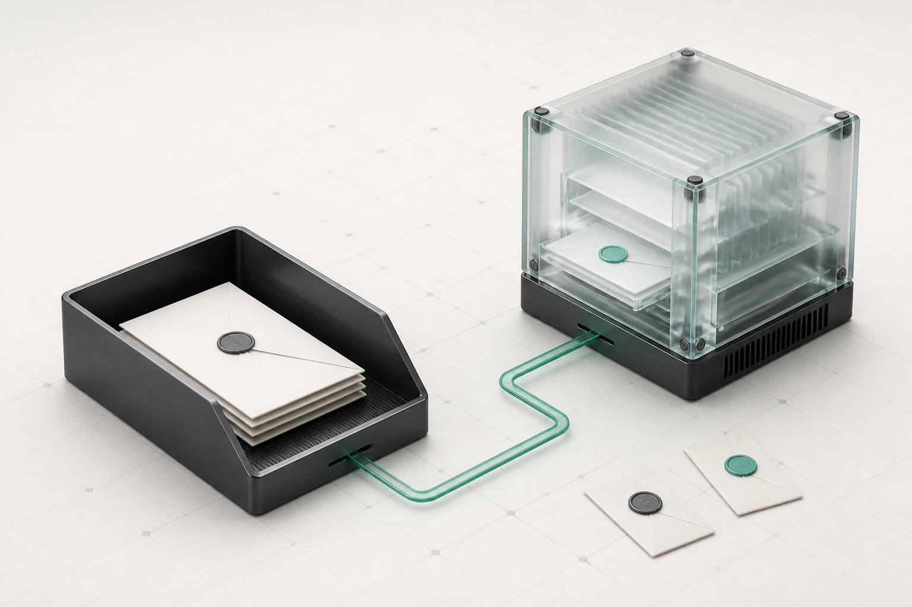

# CopilotMail V2 视觉重构与开发规格

> 状态：**设计规划已定稿；D1、D3 首个切片及 D4A（Human Mail Shell 首个切片）、
> D4B（Queue/Reading 层级切片）、D4C（Drafts/Sent metadata-only 目录切片）、
> D4D（Compose / Submission Evidence 层级切片）已经完成本地源码和仅回环浏览器验证。**
> 未完成阶段仍是后续开发规格，不是已上线能力声明，也不授权
> 将规划中的组件、页面、数据或素材直接渲染进产品。
> 当前生效的安全与交互约束仍以 [`DESIGN.md`](../DESIGN.md)、
> [`HUMAN_AGENT_UX_SPEC.zh-CN.md`](HUMAN_AGENT_UX_SPEC.zh-CN.md) 和实际 API 契约为准。

## 0. 设计决策

CopilotMail 采用一套新的、单一的产品语言：

> **Measured Agent Workbench / 有界智能体工作台**

它不是“AI 炫技面板”，也不是“普通邮箱套一层管理卡片”。它是一套让 Human 与
Agent 都能被识别、被授权、被约束、被追溯的企业邮件工作台。

本方向取用两类公开可观察的优点，而不复制任何第三方页面、Logo、文案、色值、
插画、二维码、机器人轮廓或交互流程：

| 参考来源 | 取用的抽象方法 | 不取用的内容 |
| --- | --- | --- |
| [getdesign.md 的 Linear 分析](https://getdesign.md/linear.app/design-md) | 极少的视觉语法、紧凑而稳定的信息层级、细边界、单一强调点、键盘优先的工作台节奏 | 紫色品牌、近黑营销画布、原有组件比例、页面布局和文案 |
| 用户提供的 [agent.qq.com](https://agent.qq.com/) 及 [腾讯元器公开工作台说明](https://yuanqi.tencent.com/guide/publish-agent-publish-tencent-yuanqi) | 白底内容层、分组侧栏、明确的当前上下文、一个易辨认的创建/推进动作、Agent 管理而非拟人化聊天 | 腾讯/QQ 品牌资产、绿色商标关系、吉祥物、人像、机器人脸、其任何页面或 UI 复刻 |

**核心判断：** 现在的界面并不缺“更多卡片”，而是缺少由“事实 → 决策 → 证据”
组成的稳定构图。所有后续页面重构都必须首先回答：操作者面对的是哪一个真实对象、
哪一个真实风险、哪一个已授权的下一步，以及凭什么相信它。

### 0.1 必须达成的体验结果

1. Human 与 Agent 在视觉上同等清晰，但不被伪装成同一种使用方式：Human 用网页
   完成阅读、写信和治理；Agent 用 API / SDK / 事件协议完成确定性操作。
2. 管理端从“表单和表格的平铺集合”变为“可做决策的控制面”：在首屏先看当前对象和
   可行动的风险，再看细节和不可变证据。
3. 邮件端保持高效率、键盘优先、低干扰；视觉升级不能牺牲三栏扫描速度、草稿 CAS、
   未知写入冻结或可访问性。
4. 视觉只能放大已有事实，不能制造 AI 在线、Agent Owner、投递成功、审批结果、
   执行轨迹、KPI 或下一步。
5. 设计不以渐变、彩色拼块、大面积状态底色、玻璃拟态、营销大字或装饰图形承担层级。

### 0.2 明确排除项

- 不新建“Agent 聊天控制台”、机器人头像墙、Agent 活跃度大屏、虚构运行图、动效心跳。
- 不为未来能力预留 Tab、空卡片、禁用但无解释的按钮或“即将推出”。
- 不把审计、审批、域名、保留、Legal Hold 设计成同一种无差别的 `Panel + Form + Table`。
- 不在业务 CSS 中硬编码颜色、阴影、圆角、图标或断点；不引入大型 UI 框架。
- 不把敏感 UUID、邮件正文、收件人、Token、Archive/Grant 细节放进 URL、浏览器历史、
  localStorage、预取请求、轮询或生成式图片。

## 1. 视觉样稿与素材边界

本轮使用 Image 2 生成的是**设计基准素材**，用于让开发模型和评审者对同一视觉语言
达成一致。它们尚未绑定真实产品状态，因而不是可直接加载的生产位图，不登记到
[`IMAGE2_ASSET_MANIFEST.zh-CN.md`](IMAGE2_ASSET_MANIFEST.zh-CN.md)，也不得被组件直接引用。

### 1.1 Human / Agent 邮件路由主视觉



| 项目 | 规定 |
| --- | --- |
| 文件 | `docs/assets/visual-design/human-agent-mailflow-hero-v1.png` |
| 审计源 | 1536×1024 PNG，1,992,391 B，SHA-256 `E92529EA0AE37A8D3D0C9684E68F467903850CCBC514C4FCDA60AE2C047E2F7B` |
| 角色 | 视觉方向参考：石墨邮件托盘与半透明计算邮件模块以一条受控 jade 路径相连，表达 Human / Agent 同等主体而非人格化形象 |
| 可取用 | 暖白底、石墨/纸张/玻璃的材料克制、单一 jade 路径、低对比工程网格、物件之间可解释的关系 |
| 不可取用 | 3D 质感作为日常界面背景、泛化到任意空态、图片中的封蜡细节作为产品图标、未绑定真实状态就进入 UI |
| 产品化前置条件 | 指定唯一页面、唯一真实触发状态、唯一下一步、可访问文本、移动裁切、WebP/AVIF 交付文件、哈希和截图回归 |

### 1.2 功能图标语言样稿


| 项目 | 规定 |
| --- | --- |
| 文件 | `docs/assets/visual-design/mailflow-icon-language-v1.png` |
| 审计源 | 1448×1086 PNG，979,851 B，SHA-256 `DF01C03369F4F8AAE9FA838EDFC8AB3BBC328E083A2B6D2CE8D4BF1A66CEB6C1` |
| 角色 | SVG 图标的构图、线重、留白、圆角和 jade 状态点的参考板 |
| 不可直接使用 | 这是位图，**不是** 16/20/24px 图标资源，不得以背景图、emoji、字体图标或截图方式进入产品 |
| 要求 | 每个功能图标必须继续由 `web/design-system/src/icons.tsx` 中原创、可访问的 SVG 路径实现 |
| 允许的图形语法 | 24×24 viewBox；1.75px 默认描边；圆端点与圆连接；几何尽量不超过 4 个基础形；仅状态点可小面积填充 |

### 1.3 Image 2 生成记录

| 素材 | 生成意图 | 必须避免 |
| --- | --- | --- |
| `human-agent-mailflow-hero-v1.png` | 用可解释的实体关系表达双主体邮件路径 | 文案、Logo、界面截图、拟人化角色、彩虹色、霓虹、无意义背景 |
| `mailflow-icon-language-v1.png` | 确立原创 SVG 的轮廓、线宽和单点状态语言 | 字母、数字、商标、渐变、假 UI、位图图标投产 |

若后续决定使某张新图片进入产品，必须重新从具体真实状态生成或裁切，而不是把本样稿
直接压缩后上线。生产素材生命周期只遵循现有 Image 2 清单和 Bundle 门禁。

## 2. 统一视觉基础

### 2.1 色彩：纸、墨、受控 jade，而不是颜色拼图

目标 token 仍使用 `--cm-*` 命名；新设计的改动必须先在
`web/design-system/src/styles.css` 中定义，再迁移两个应用。下表是**目标值与语义**，
执行时应使用现有设计门禁复核关键对比度，不能以本文色值绕过验证。

| 层级 | 目标 token | 目标值 | 唯一职责 |
| --- | --- | --- | --- |
| Canvas | `--cm-canvas` | `#F8F8F6` | 应用暖白底；永不承载状态色 |
| Surface | `--cm-surface` | `#FFFFFF` | 阅读、表格、表单、Dialog 的实体表面 |
| Subtle surface | `--cm-surface-subtle` | `#F2F4F3` | 选中前悬停、密集分组、非关键辅助背景 |
| Ink | `--cm-ink` | `#17202A` | 主要文本、主操作、图标轮廓 |
| Muted | `--cm-muted` | `#667085` | 元数据、说明、次级信息；不可用于低对比正文 |
| Line | `--cm-line` | `#E1E6E3` | 结构线、表格分隔、面板边界 |
| Control boundary | `--cm-control-border` | `#7A8795` | 输入框和次要操作的可感知边界；在白色表面保持至少 3:1 对比 |
| Agent / action | `--cm-agent` | `#0F766E` | 已授权主动作、键盘焦点外环、真实 Agent 关联、选中路径 |
| Agent soft | `--cm-agent-soft` | `#E7F4F1` | 仅用于紧凑的 Agent/选中辅助层 |
| Positive | `--cm-positive` | `#18794E` | 已由后端确认的成功/完成；不是“主按钮绿” |
| Warning | `--cm-warning` | `#996300` | 需要注意、等待、人工复核 |
| Critical | `--cm-critical` | `#B42318` | 失败、破坏性动作、拒绝 |
| Info | `--cm-info` | `#245FC7` | 解释性系统信息；不代表 Agent |

规则：

- 一屏的主色面积应以 Canvas / Surface / Ink 为主；任意语义色的连续背景面积不超过
  可视内容区的 12%。
- `--cm-agent` 是**操作与焦点**颜色，不是 Agent 的唯一身份颜色；Agent 必须同时有
  形状、图标和可见文本。
- `Positive` 与 `Agent/action` 不能互相替代。已接受不是已投递，Agent 不等于成功。
- 不允许线性渐变、彩色环境光、发光描边、彩虹状态芯片、无语义浅色卡片。
- 颜色迁移应分两步完成：先增加/验证语义 token 与兼容层，再替换各业务 CSS；绝不能
  直接全局搜索替换 `#3F39B8`。

### 2.2 字体、数字与内容密度

共享 font stack 必须同时覆盖 Latin 与简体中文，并在 Admin、Mail、Dialog、命令面板、
原生控件中一致：

```css
--cm-font-sans: Inter, "PingFang SC", "Microsoft YaHei", "Noto Sans CJK SC",
  ui-sans-serif, system-ui, -apple-system, BlinkMacSystemFont, "Segoe UI", sans-serif;
--cm-font-mono: "SFMono-Regular", Consolas, "Liberation Mono", Menlo, monospace;
```

本期不依赖外部字体 CDN；若后续自托管字体，必须单独评审 CJK 包体、授权、子集策略和
离线回退。ID、哈希、Trace、UUID 和快捷键才使用等宽字体，正文和邮件主题始终使用 sans。

| 角色 | 字号 / 行高 | 字重 | 使用范围 |
| --- | --- | --- | --- |
| Evidence micro | 12 / 16 | 500 | Hash、短 ID、辅助时间；必须可复制并允许换行 |
| Metadata | 13 / 18 | 500 | 列表元数据、标签说明、字段标签 |
| Body | 14 / 20 | 400 / 500 | 表格、正文、表单和通用阅读 |
| Body comfortable | 16 / 24 | 400 | 邮件正文、较长说明 |
| Section title | 20 / 28 | 650 | 页面内事实/决策/证据分区标题 |
| Page title | 28 / 36 | 650 | 当前资源、当前工作流名称 |
| Decision title | 32 / 40 | 650 | 极少量的高风险决策页面；不用于每张卡 |

文字不使用全大写装饰。中文、英文、邮箱、UUID、哈希、长主题和多收件人必须在 390px
宽度下不遮挡主动作；长值采用 `overflow-wrap: anywhere`，但临近复制按钮时需保留可扫描
的首尾片段与完整可访问名称。

### 2.3 间距、圆角、层级与动效

从当前零散的 10/13/14/18px 收敛为 4px 基准、8px 主节奏：

| Token | 值 | 用途 |
| --- | --- | --- |
| `--cm-space-1` | 4px | 图标与极短文字、证据内行距 |
| `--cm-space-2` | 8px | 控件内间距、紧凑字段 |
| `--cm-space-3` | 12px | 列表项、状态行 |
| `--cm-space-4` | 16px | 常规分组、表单字段 |
| `--cm-space-5` | 20px | 面板内边距、详情块 |
| `--cm-space-6` | 24px | 页面分区 |
| `--cm-space-8` | 32px | 核心区块间距 |
| `--cm-space-10` | 40px | 空状态/首屏的垂直呼吸 |
| `--cm-space-12` | 48px | 宽屏页面的一级分区 |

- 控件圆角 8px，信息表面 12px，Dialog 14px，身份/状态小胶囊仅在短状态中使用 999px。
- 平面优先：层级由位置、边界和留白构成。只允许两级低对比阴影，不能用阴影制造
  “漂浮的大卡片墙”。
- 交互动效只用于关系变化：120ms hover/press、160ms disclosure、200ms Dialog；
  不能有无限脉冲、执行假象、内容自动漂移或由动效表达状态。
- `prefers-reduced-motion: reduce` 下过渡缩为即时，Spinner 静止，仍保留文本状态。

## 3. 信息架构与版式

### 3.1 三个入口，不做一个大杂烩

```text
CopilotMail
├── Human Mail Workspace
│   ├── 授权的邮箱范围
│   ├── 邮件队列、搜索、阅读、写信、草稿、提交证据
│   └── 按需 Evidence Inspector
├── Human Control Plane
│   ├── 指挥台
│   ├── 执行与审核：域名、审批、案件、Legal Hold
│   ├── 证据与留存：审计、导出、保留
│   └── 身份与自动化：Agent Inspector、角色
└── Agent Client Surface
    ├── API / SDK / Token Scope / Idempotency / CAS
    ├── 结构化错误与事件协议
    └── 不提供“让 Agent 点击网页”的镜像 UI
```

Human 与 Agent 是一等公民，含义是授权、身份、审计和资源边界同等严肃；并不意味着
Agent 页面要模拟 Human 收件箱，也不意味着 Human 控制面可以伪造 Agent 运行状态。

### 3.2 Admin Shell：由分组导航支撑决策

宽屏（≥1280px）采用固定左 rail + 可伸缩工作区：

```text
┌──────────── 240 ────────────┬──────────────────── 主工作区（max 1440） ───────────────────┐
│ 产品标记 / 组织上下文          │ Breadcrumb（仅非敏感资源） / 当前页面                         │
│                               │ ┌─ Decision Header ──────────────────────────────────────┐ │
│ 指挥台                         │ │ 真实对象 + 状态 + 一个主动作 + 可选事实                  │ │
│                               │ └───────────────────────────────────────────────────────┘ │
│ 执行与审核                     │ ┌── Facts ──────────────┐  ┌── Decision ───────────────┐ │
│  · 邮件域名                    │ │ 列表 / 资源事实          │  │ 条件、影响、表单、确认      │ │
│  · 审批                        │ └────────────────────────┘  └────────────────────────────┘ │
│  · 案件 / Hold                 │ ┌── Evidence ────────────────────────────────────────────┐ │
│                               │ │ 不可变时间线、审批、Request/Trace ID、导出账本            │ │
│ 证据与留存                     │ └────────────────────────────────────────────────────────┘ │
│ 身份与自动化                   │                                                            │
└───────────────────────────────┴────────────────────────────────────────────────────────────┘
```

- Rail 宽度 232–248px；不压缩文字标签成图标墙。
- 页面内容最大宽 1440px，最小左右页面留白 24px；不会把数据表强行拉到超宽可读性之外。
- 同一页面的主动作最多一个；当有多个真正可行操作时，按风险选一个主动作，其他进
  溢出菜单或上下文 Inspector。
- 1024–1279px 保留窄 rail（64px 仅在有可访问名称与展开机制时）；≤1023px 使用
  当前页面标题 + 分组抽屉，不能挤压内容区。
- 任何敏感 Agent / Audit evidence UUID 查询都不形成 URL 路由或浏览器历史条目。

### 3.3 Mail Shell：效率优先的三栏，不改造成仪表盘

```text
┌ Scope rail 224 ┬ Queue 328–400 ┬ Detail / Compose min 520 ┬ Inspector 360 (按需) ┐
│ mailbox         │ 搜索 / 过滤     │ 主题、参与者、正文、操作                 │ 证据 / 策略 / 追踪  │
│ identity        │ 真实列表         │ 草稿、提交、人工复核、失败或未知         │ 默认关闭             │
└─────────────────┴──────────────────┴────────────────────────────────────────────┴────────────────────┘
```

- 队列只服务扫描和导航；阅读区只服务理解和完成任务；证据区只在服务端返回对应证据时
  出现，且默认收起。
- 草稿、已发送等接口无详情数据时，采用宽列表而不是一个空白详情栏。
- ≥1084px 使用 224px Scope rail、328–400px Queue 与至少 520px Reading；1008–1083px
  收敛为仍有文字和完整邮箱事实的 160px rail 与 328px Queue；≤1007px 变为显式列表—
  详情栈，绝不把桌面三栏压成三条窄列。所有关键控制最小 44×44px，独立于
  `pointer: coarse`。

## 4. 从“卡片堆叠”到“事实 → 决策 → 证据”

### 4.1 复合组件目录

基础组件继续由 `web/design-system` 管理；以下是**有明确业务语义的复合组件**，而不是
再造通用卡片。

| 组件 | 显示的真实内容 | 允许放置的位置 | 绝不显示 |
| --- | --- | --- | --- |
| `DecisionHeader` | 资源名称、可见状态、主体/组织范围、最后确认时间、唯一主动作 | Admin 详情/工作流首屏 | 假 KPI、装饰统计、多个同权 CTA |
| `FactStrip` | 3–6 个 API 字段：标签、值、证据时间 | Decision Header 下方 | 前端推断 Owner、在线、投递成功 |
| `DecisionGate` | 操作条件、影响对象、所需理由/审批、确认入口 | 高风险写操作前 | “确定/继续”式无上下文按钮 |
| `EvidenceTimeline` | 不可变 Audit、审批步骤、请求/Trace、明确时间来源 | 证据区 / Inspector | 本地拼装的虚构过程、无时间来源的事件 |
| `AgentDossier` | 精确 Agent 身份、真实生命周期、Scope 交集、控制面快照 | Agent Inspector | 聊天窗、头像、心跳、执行状态 |
| `SecureExportGate` | Archive、双人批准、Grant 有效期、下载账本 | 审计导出 | “普通附件下载”、隐含授权 |
| `LifecycleRail` | 域名、审批、保留的已实现状态转移 | 资源详情 | 未实现阶段、未来节点 |
| `ActionableEmptyState` | 当前无真实数据/无权限/失败原因和已有下一步 | 列表或单一流程空态 | 通用插画、假建议、死按钮 |

### 4.2 组件的视觉结构

```text
DecisionHeader
├── eyebrow: 资源类别（可本地化，不作为装饰）
├── title: 真实资源或当前任务
├── status: 图标 + 文本 + 已知时间/证据
├── facts: 3–6 个已授权、可解释字段
└── action: 0 或 1 个真正可执行的主动作

EvidenceTimeline
├── event: 时间（带来源）
├── actor: Human / Agent / Service 的文本 + 原创图标
├── action: 审计目录中的真实动作名的本地化解释
├── evidence: request/trace/approval/archive 只在契约提供时出现
└── disclosure: 默认折叠长 UUID / Hash，但不丢失复制能力
```

每个复合组件必须定义 loading、empty、denied、error、readonly、unknown 和 ready 状态。
这些状态均映射真实 API 条件和现有下一步，不得通过一张无语义插画掩盖。

## 5. 逐页设计规格

### 5.1 Human Mail：Inbox、阅读、写信

| 区域 | 视觉职责 | 真实信息 | 主动作 | 禁止项 |
| --- | --- | --- | --- | --- |
| Scope rail | 清晰回答“我在哪个邮箱、以何身份操作” | 授权邮箱、IdentityBadge、会话状态 | 切换已授权范围 | 靠颜色识别身份、假 Owner/委托 |
| Queue | 高速扫描与导航 | 发件人、主题、时间、未读、附件、真实风险提示 | 打开选中邮件 | KPI、装饰缩略图、详情预取 |
| Reading | 阅读优先 | 主题、参与者、正文、附件、真实动作 | 现有受授权动作（当前为回复） | 把已接受写成已送达 |
| Compose | 减少决策成本 | 不可编辑的当前发件身份、收件人、纯文本正文、草稿/提交状态 | 发送或确认同一提交 | 手动保存、Agent 自动补写、假投递进度 |
| Submission state | 清晰区分事实 | 服务端 `pending` / `reconciling` / `accepted` / `rejected` / `manual_review`；本地草稿与未知请求冻结 | 现有的精确对账或人工下一步 | 无限 Spinner、盲目重试、把客户端未知写成服务端状态 |
| Evidence inspector | 可按需证明而非干扰写信 | 当前同一提交的最小 ID、状态、版本、确认时间与可选投递聚合 | 展开/复制真实引用 | 自动展开、Actor/Policy/Trace 扩大披露、正文/敏感 Token |

视觉重点：未读状态通过字重、位置、图标和文本辅助而非仅色条；移动范围摘要在未展开时
仍给出邮箱地址、身份文字与服务端可发送性，低频切换/会话控件才按需展开；写信表单把
发件范围和身份留在上下文事实区，把同一 `can_send` 状态紧凑放在标题旁，把唯一“提交状态”
贴近发送或确认同一提交的动作；`manual_review`
使用真实、专属的已登记插画，而不是本轮样稿。

#### D4A 首个实现切片（2026-08-24）

`web/mail-app/src/shell/MailWorkspaceShell.tsx` 现只承载既有桌面导航、移动工具栏、内容和
Overlay 的结构插槽；请求、认证、快捷键、焦点、Abort/代际隔离、草稿 CAS 和未知提交冻结
仍留在原有控制边界。当前实现以可读性而非压缩列数为优先：≥1084px 为 224px Scope rail、
328–400px Queue 和至少 520px Reading；1008–1083px 保留具文字和完整邮箱事实的 160px rail
与 328px Queue；≤1007px 显式切换为列表—详情栈。该切片没有增加 API、权限、预取、缓存、
URL/存储状态或轮询。

移动端把低频的邮箱切换、语言和退出收在原生 `details` 披露中；关闭态仍能看到真实邮箱地址、
身份文字和 `can_send` 派生的可发送性，因而不会为了简洁而隐藏当前操作范围。写信的唯一提交
状态移至 footer，并紧邻“发送”或“确认同一提交”动作；它不构造 Agent Owner、在线/运行、
策略或投递成功状态。字段和禁止渲染项的权威映射见
[`DESIGN_D4_MAIL_FIELD_MAPPING.zh-CN.md`](DESIGN_D4_MAIL_FIELD_MAPPING.zh-CN.md)。

该首个 D4A 切片已在本地通过 `npm run check`、404 条 Vitest（设计系统 17、Admin 207、
Mail 180）、`npm run build` 与 `npm run e2e:run`（96/96，仅回环 Chromium）；73 张 PNG
基线（Admin 40、Mail 33）已人工审图。这是 D4A 完成时的历史证据。

#### D4B Queue 与 Reading 层级（2026-08-24）

D4B 按 [`DESIGN_D4B_QUEUE_READING_MAPPING.zh-CN.md`](DESIGN_D4B_QUEUE_READING_MAPPING.zh-CN.md)
将 Queue 的真实信封字段收敛为可扫描层级，并将 Reading 的标题、元数据与既有动作排列为纯呈现
结构。它保留 `j`/`k` 仅移动选择、点击/`Enter` 才读取详情、Abort/代际隔离、精确回复关系、草稿
CAS 与未知提交冻结；不新增 API、权限、预取、缓存、路由或 Agent 运行态事实。

本轮以 408 条 Vitest（设计系统 17、Admin 207、Mail 184）、101/101 条仅回环 Chromium 与
77 张 Windows PNG（Admin 40、Mail 37）完成全量 Web 门禁和人工审图。它只证明固定 BFF 夹具
下的界面与回归契约，不能证明真实 RBAC、后端 CAS/幂等、数据库、IdP、Docker、NixOS 或生产
邮件依赖。**这是 D4B 完成时的历史证据；当时 D4 已完成 D4A 与 D4B 两个切片。**

#### D4C Drafts / Sent metadata-only 目录与 Compose footer 可读性（2026-08-24）

D4C 按 [`DESIGN_D4C_DRAFTS_SENT_MAPPING.zh-CN.md`](DESIGN_D4C_DRAFTS_SENT_MAPPING.zh-CN.md)
将 Drafts 收敛为草稿类型、收件人数、更新时间和既有恢复动作；Sent 只呈现接受时间、收件人数
及可选的真实投递聚合。它不显示 UUID、版本、地址、正文、Provider/SMTP 或单收件人结果，不建立
详情、读取、轮询、预取或新的行操作。Compose 只修复既有长状态提示的换行可读性，提交顺序、
未知提交冻结和对账不变。

在 D4C 完成时，以 411 条 Vitest（设计系统 17、Admin 207、Mail 187）、103/103 条仅回环 Chromium 与
79 张 Windows PNG（Admin 40、Mail 39）完成当时的 Web 门禁和人工审图。**当时 D4 已完成 D4A、D4B
与 D4C 三个切片；后续 D4D 的当前证据见下一节。** 该证据只覆盖固定 BFF
夹具，不证明真实 RBAC、后端 CAS/幂等、数据库、IdP、Docker、NixOS 或生产邮件依赖。

#### D4D Compose / Submission Evidence 层级（2026-08-24）

D4D 按 [`DESIGN_D4D_COMPOSE_MAPPING.zh-CN.md`](DESIGN_D4D_COMPOSE_MAPPING.zh-CN.md) 将写信窗口
收敛为“授权范围与身份 → 信封/正文 → footer 的同一提交状态 → 默认收起证据”。`can_send` 保留
原有的文本、图标、`data-sendable` 和 tone，但从第三个并列 fact 进入 ContextBar 标题旁的 status
槽；范围与身份仍是仅有的两项 definition-list facts。`ComposerSubmissionEvidence` 只消费既有
窄投影，继续拒绝邮箱/草稿绑定、单收件人、SMTP、Provider 和 Agent 控制面字段；人工复核插画仍
仅在真实 `manual_review` 展开后出现。

本轮通过 411 条 Vitest（设计系统 17、Admin 207、Mail 187）、104/104 条仅回环 Chromium 和
88 张 Windows PNG（Admin 40、Mail 48）。新增正常 Compose 的 1440/1008/390px、unknown 的
1008px、manual review 展开证据和恢复草稿基线；同时复核 Context Strip 无 `aria-live`、unknown
不创建第二次提交、D4D Compose Axe A/AA、焦点环和 390px 无横向溢出。**D4 已完成 D4A、D4B、
D4C 与 D4D 四个切片；其余 Mail 视觉重构仍须逐页完成字段映射和同级回归。** 这些固定 BFF
夹具不证明真实 RBAC、后端 CAS/幂等、数据库、IdP、Docker、NixOS 或生产邮件依赖。

#### D4E Access / Session Trust Gate（2026-08-24）

D4E 按 [`DESIGN_D4E_ACCESS_SESSION_MAPPING.zh-CN.md`](DESIGN_D4E_ACCESS_SESSION_MAPPING.zh-CN.md)
将进入 Human Mail 的状态拆成两个不混淆的呈现面：`MailAccessSurface` 只在登录、登录错误和
检查中使用已登记的 `mail-agent-routing-v1.webp`；已经认证的邮箱目录加载、目录为空和目录读取
失败只显示窄的事实与已有下一步，不再伪装成登录页。`SessionVerificationNotice` 在已打开的
工作台之上显示可见、非模态的复核事实：检查中为单一 `role=status`，失败为程序化聚焦的
`role=alert`；底层 `mail-shell` 继续由既有 `inert` / `aria-busy` 锁定。

这只是纯呈现拆分。认证、Cookie、目录精确分页、初始十页上限、Abort/generation 隔离、邮箱
绑定、会话重试/退出、焦点恢复、草稿 CAS 与未知提交冻结仍由 `App.tsx` 及既有控制器拥有；
没有新增 API、DTO、权限、URL、浏览器存储、缓存、轮询、预取或生产位图。D4E 不显示
`HumanSessionResponse` 的主体/组织/客户端/到期时间，不显示 mailbox ID、Cursor、Owner 或任何
Agent 运行/策略推断。

新增固定夹具覆盖英文/简体中文登录、已确认目录为空、目录暂不可用及会话复核失败的
1440/901/390px，含 Axe A/AA、无横向溢出、44px 几何与无额外 Mail 资源读取断言。当前本机
受限 worker Vitest 为 411 条（设计系统 17、Admin 207、Mail 187），Chromium 为 109/109，PNG
基线为 103 张（Admin 40、Mail 63）；其中 D4E 为 15 张。所有证据均来自回环 Vite 产物和内存
BFF 夹具，不证明真实 RBAC、数据库、IdP、Docker、NixOS 或生产邮件依赖。

### 5.2 Admin Overview：从两个数字卡变成真实待决事项

当前 Overview 只可靠读取开放案件和有效 Hold。因此首个重构只能使用这两个真实来源；
任何“今日风险”“运行健康”“Agent 数量”“邮件量”都必须等待对应 API。

```text
DecisionHeader: “控制面” + 组织上下文
├── 若存在开放案件：优先显示“需复核的开放案件”及进入 Cases 的一个动作
├── 否则若存在有效 Hold：优先显示“当前有效 Legal Hold”及进入 Holds 的一个动作
└── 若两者均为 0：明确说明“当前可读取范围内没有待处理的案件或有效 Hold”，不补假建议

事实区：开放案件数、有效 Hold 数（各自真实加载/拒绝/错误状态独立）
证据区：本期不新增；没有可读 Audit 聚合时不造时间线
```

这不是大屏，也不是 KPI 卡墙。优先级只能从已取回的对象与授权状态得出；403 与网络
错误必须保持分离，不能以 0 代替。

#### D3 首个实现切片（2026-08-24）

`web/admin-app/src/OverviewView.tsx` 已将上述规则落为可测试的显式决策表：开放案件非空时
只能进入 Cases；只有开放案件已确认为空且有效 Hold 非空时才能进入 Holds；两项均确认
为空时没有 CTA；任一来源仍在加载、被拒绝或失败时显示“尚无法确认一个下一步”，绝不把
未知当作零。事实区仍只发起既有的两次受审计读取，未新增预取、轮询、汇总 API 或把
Case/Hold ID 写入 URL。

同一切片把 Admin Shell 收敛为：≥1280px 保留带文字的 236px rail、1024–1279px 使用具备
可访问名称的 44px panel 控件打开完整抽屉、≤1023px 显示当前页面与分组抽屉；语言和退出
等会话控制也进入窄屏抽屉，不会因 rail 收窄而消失。工作区最大宽度为 1440px。Overview
的主 CTA 导航后将焦点移至主工作区并播报当前页面；抽屉内导航仍保持关闭后回到显式菜单
触发器的既有焦点契约。

该页面切片已在本机完成可复现验证：`npm run check`、402 条 Vitest、生产构建和 Bundle
门禁、以及 94 条仅回环 Chromium Playwright 均通过。后者覆盖 1440/1280/1024/768/390px、
中英文管理页面、Axe、键盘焦点和无横向溢出；它不访问 IdP、数据库、邮件引擎、CDN 或生产
网络，也不构成部署或真实依赖验收。

这仍只是 D3 的首个页面切片，不代表其余管理页面已经完成 Decision Header 重构；后续页面
必须各自完成真实字段映射与相同级别的浏览器回归，不能借 Overview 的通过状态扩大可见性。

### 5.3 Mail Domains：生命周期作为资源决策页面

- `DecisionHeader`：域名、当前控制面状态、最后确认时间、一个允许的主动作。
- `LifecycleRail`：只渲染服务端已定义的 `registered → DNS verified → control-plane active →
  engine pending/ready/failed` 等真实状态；每个节点有图标、文本、时间/原因。
- 事实区：DNS 证据、路由版本、已授权操作范围；引擎投影与控制面状态必须分层显示。
- 决策区：只有权限与后端状态允许的验证、激活、重试等操作；高风险动作使用
  `DecisionGate`。
- 证据区：Audit/Request ID 仅在 API 已提供时出现；不得把“待引擎同步”画成流动动画。

### 5.4 Approvals、Cases、Legal Holds：用决策语法，不用表单墙

| 页面 | 首屏事实 | 决策区 | 证据区 | 不得简化成 |
| --- | --- | --- | --- | --- |
| Approvals | 请求对象、所需票数、到期、当前状态 | 批准/拒绝及理由（仅可执行时） | 不可变步骤、Actor、完成时间 | 两个无上下文按钮 |
| Cases | 案件状态、资源范围、当前可读摘要 | 新建/关闭/关联动作（仅已有 API） | 审计关联与请求引用 | 伪造案情进度或 SLA |
| Legal Holds | Hold 范围、期限、状态、审批边界 | 创建/释放/审批等真实动作 | 保留证据、审批、Archive 引用 | “锁定成功”视觉动画 |

列表页遵循“筛选 / 结果 / 选择后详情”的一体结构：有真实过滤器才显示，筛选器没有值时
不占一行；窄屏在列表和详情间明确返回，不留空白详情栏。

### 5.5 Audit 与导出：默认压低信息，关键处抬高风险

- 审计查询的主视觉是可扫描的事件列表与精确筛选，不是装饰性数据可视化。
- `SecureExportGate` 必须把 `Archive → 双人批准 → Grant → 下载账本` 分为四个事实层，
  每层显示真实状态、范围、到期时间和下一步。
- 创建 grant、查看 grant、下载 artifact 都应明确写入审计：页面不预取、轮询或自动
  执行这些读取/下载动作。
- 下载按钮必须同时显示 artifact 类型、大小、内容类型、Grant 有效性和会被记账的事实；
  不得伪装成附件图标。
- 有权但无当前 grant 的首次说明只能使用已登记的 `audit-evidence-chain-v2`，且仅和真实
  Archive/Approval 输入同屏；拒绝、过期、无权限、未知对象不能复用它。

### 5.6 Agent Inspector 与精确发件证据：像档案，不像控制室

```text
Agent Dossier
├── 主事实：精确 Agent ID、类型、生命周期（仅 API 返回）
├── 边界：Owner / Scope / 组织范围（仅 API 返回）
├── 控制面快照：明确“观测时间”和数据来源
├── 精确发件证据入口：需先确认 Agent，再输入 submission UUID
└── Evidence：请求、准入、策略批准、可选投递聚合、最小审计引用
```

必须保留现有 P3 边界：

- 页面发起的是带 Origin/CSRF 保护的 `POST`
  `/api/v2/agents/{agent_id}/mail-submissions/{submission_id}/evidence`；成功读取会写审计
  证据，因此不得预取、缓存、重放或把输入值写进 URL。
- 只允许同时具备 `identity.manage` 和 `audit.read` 的 Active Human；不存在、跨租户、
  非 Agent 主体、双 UUID 不匹配、生产准入失败等情形统一非披露。
- 不能显示运行中、在线、执行次数、收件人、邮箱、正文、SMTP/提供方、Agent 所属关系或
  委托，除非响应显式返回对应字段。
- `delivery=null` 仅表示本响应没有快照；不得由此或 `accepted` 推导“已投递”。

### 5.7 Roles：权限阅读和变更必须同屏可解释

- 首屏显示真实主体、角色、Scope 及当前状态；身份始终含文字、图标和可见类型。
- 变更区使用 `DecisionGate`，显式写出影响主体、最小 Scope、批准/理由（如 API 支持）。
- 审计区显示真实 actor、时间、请求/Trace；不把 role mutation 做成无痕 switch。
- “Service” 是持久 Actor 名称，不得为了图形统一改叫“System”。

## 6. 图标与身份系统

### 6.1 图标规则

1. 只维护稳定、可跨页面复用的概念；新增概念先进入 `ICON_NAMES`，再进入
   `ICON_REGISTRY`，不允许各业务文件内联私有 SVG。
2. 图标用形状表达概念：Agent 是圆角邮件核心与执行轨；Human 是圆形轮廓；Shared 是双托盘；
   Group 是路由节点邮箱；Service/System 是受边界的核心。
3. 24px 为基础网格；20px 用于元数据，16px 用于紧凑状态，32px 只用于空态/关键说明。
   缩放不改变描边逻辑或添加第二种填充风格。
4. `title` 或相邻可见文本是交互图标的可访问名称；纯装饰图标显式 `aria-hidden`。
5. jade 点只表示受控的当前路径、已知行动焦点或紧凑状态，不承担概念本身。

### 6.2 身份与状态的交叉规则

| 维度 | 必须组合 | 不能单独使用 |
| --- | --- | --- |
| Human / Agent / Shared / Group / Service | 图标形状 + 可见文本 + 有数据时的事实字段 | 颜色、机器人头像、邮箱地址猜测 |
| 成功 / 等待 / 失败 / 信息 | 状态图标 + 本地化文字 + 真实时间/原因 | 绿色勾、闪烁动画、色块背景 |
| 权限边界 | Scope/状态/拒绝原因 + 合法下一步 | 灰掉按钮而无说明 |
| 高风险动作 | 对象 + 影响 + 审批/理由 + 确认 | 通用“确定/继续” |

## 7. 响应式、可访问性与国际化

### 7.1 响应式矩阵

| 宽度 | Mail | Admin | 设计验收 |
| --- | --- | --- | --- |
| 1440px | 三栏 + 按需 inspector | 完整 rail + 双列事实/决策 | 高密度但不压缩正文/表格 |
| 1280px | 三栏收缩、Inspector 仅显式展开 | 完整 rail，内容 max 约束生效 | 长标题、中文按钮、表格横向策略 |
| 1024px | 160px 文字 rail、328px Queue 与至少 520px Reading | 窄 rail 或可展开导航 | 不能发生列挤压或无标签图标导航 |
| 768px | 显式列表—详情栈 | 顶栏 + 分组抽屉 | 行动按钮、Dialog、证据折叠可操作 |
| 390px | 一次一个任务，返回路径明确 | 当前页面优先，抽屉不遮挡焦点 | 44×44px、长 UUID/邮件/中英文、横向滚动可控 |

### 7.2 可访问性硬门槛

- WCAG 2.2 AA 对比度、可见双环焦点、键盘完整路径、屏幕阅读器语义、减少动画均不回退。
- 重点状态不能以颜色作为唯一通道；`aria-live` 只用于真实异步变化，不能广播每次渲染。
- Dialog / ConfirmDialog 的 Portal、`aria-modal`、背景 inert、Tab 环绕、Escape、busy 锁定、
  焦点恢复逻辑继续复用共享实现。
- 表格必须有列标题、排序/筛选语义和窄屏策略；禁止把数据表用 div 假装表格。
- `disabled` 不是解释：无权限、只读、未知写入或审批不足均要有可见理由与适用的下一步。

### 7.3 中英文内容准则

- 不能把缩写当作完整中文/英文标签；“Agent”“Human”“Service”等身份词按当前 i18n
  目录明确翻译/保留策略，不能由组件补隐式英文。
- 中文按钮采用动词 + 对象（例如“创建导出授权”），英文采用简洁动词短语；危险动作
  要包含对象或影响词。
- 时间统一由后端源时间格式化；所有相对时间必须能获得绝对时间的可访问文本。
- UUID/Hash/Trace 可复制、有等宽展示和首尾阅读策略，但不在标题抢占阅读层级。

## 8. 安全和数据忠实度：设计不得改变的行为

| 约束 | 设计实现要求 |
| --- | --- |
| 默认拒绝 / Fail Closed | 403、404、scope 缺失、租户不匹配、未知写入不以“空数据/成功”伪装；业务读取前的拒绝没有视觉侧信道 |
| 审计原子性 | 写操作与 audit/outbox 同事务；界面只能消费已提交的事实，不能画乐观审计线 |
| 高风险审批 | 显示真实对象、请求人、所需票数、有效期、影响和当前状态；批准不可被其他主体复用 |
| Agent 精确证据 | POST、Origin/CSRF、无预取、无 URL 留痕、默认折叠审计引用、非披露错误语义 |
| 时间来源 | 审计、准入、终态、投递使用 PostgreSQL 的权威事实时间；前端不能使用本机时钟重排或补齐因果 |
| 隐私 | 邮件正文、附件、收件人、Token、敏感 Trace 与 archive artifact 不进入插画、KPI、URL、日志或无权视图 |

## 9. 开发架构与迁移边界

### 9.1 目标代码层次

```text
web/design-system/
├── tokens：颜色、字型、spacing、半径、阴影、焦点、层级、动效
├── primitives：Button、Field、Panel、Badge、Dialog、EmptyState、StatusIndicator
├── identity：IdentityBadge、共享身份映射
├── evidence：EvidenceInspector、EvidenceTimeline（仅无业务 API 的视觉层）
└── icons：唯一原创 SVG registry

web/mail-app/
├── shell：三栏 / 列表详情栈 / 快捷键与焦点
├── mail：队列、阅读、写信、草稿、提交状态
└── evidence：按需、最小、服务端事实驱动

web/admin-app/
├── shell：导航、当前上下文、窄屏抽屉
├── decision：DecisionHeader、DecisionGate、FactStrip
├── governance：domains / approvals / cases / holds / retention / roles
└── evidence：audit / export / agent dossier，均按精确 API 契约隔离
```

`web/mail-app/src/App.tsx` 已经偏大。视觉重构时先提取可测试的壳、选择控制器和状态
边界；不要为了“完成 UI”继续把视觉、请求、鉴权、定时、CAS 和错误处理堆进该文件。

### 9.2 不允许的抽象

- 不创建万能 `Card` API 来塞进所有页面；只有可解释的 `DecisionHeader`、`FactStrip`、
  `DecisionGate`、`EvidenceTimeline` 等复合组件可以跨页面共享。
- 不让 `design-system` 调用业务 API、推断状态或持久化数据；它只承载可访问视觉与
  结构。
- 不把 Human Mail 与 Admin 的布局/业务组件强行共用；它们只共用 token、primitives、
  identity、icons、Dialog 和 Evidence 的无业务壳。
- 不为 Agent 写另一个网页外壳；Agent 的真实一等公民入口继续是版本化 API / SDK。

## 10. 实施计划表

以下阶段按依赖顺序实施。每个阶段只在前一阶段的 TypeScript、测试、设计门禁和截图
通过后开始；阶段不代表可以跳过真实 API、后端安全或文档门禁。

| 阶段 | 工作内容 | 主要目录 | 交付物 | 通过条件 |
| --- | --- | --- | --- | --- |
| D0 设计冻结 | 评审本规格、确认 jade token 迁移、选定首批页面和真实 API 字段 | `docs/` | 已签字的页面/字段映射与反例清单 | 无计划字段被当成可渲染事实 |
| D1 Token 基础 | 引入字体、spacing、type、z-index、motion token；保留兼容别名 | `web/design-system/src/styles.css` | 单一 token 层、迁移说明 | 对比度/设计治理门禁通过；业务 CSS 无新 raw 值 |
| D2 图标与 primitives | 在现有 SVG registry 内补稳定图标；微调 Button/Field/Panel/Badge/Focus | `web/design-system/src/` | 可访问的原始 SVG 和基础组件 | 单元测试、Axe、键盘、无 emoji/位图图标 |
| D3 Admin Shell | 重构 rail、分组导航、窄屏抽屉、页面标题和 Context/Decision Header | `web/admin-app/src/App.tsx`、`styles.css` | 新壳但不改 API 语义 | 中英文 + 1440–390px 截图；敏感证据不入 URL |
| D4 Mail Shell（D4A、D4B、D4C、D4D、D4E 切片已完成） | 从 `App.tsx` 提取壳/控制器，升级 rail、queue、detail、compose 的层级 | `web/mail-app/src/` | D4A 已交付可读三栏/栈式壳与移动范围披露；D4B 已交付真实 Queue/Reading；D4C 已交付 Drafts/Sent metadata-only 目录；D4D 已交付 Compose Context Strip 与最小 Submission Evidence 的 display-only 边界；D4E 已交付登录/目录准入与会话复核的纯呈现边界；其余 Mail 重构继续分片 | 草稿 CAS、未知写入、快捷键、44px 命中区不回退 |
| D5 决策页面 | 先落地 Domains、Approvals、Cases、Holds 的 Fact/Decision/Evidence 结构 | `web/admin-app/src/*View.tsx` | 有真实字段映射的复合页面 | 无假 KPI、无空卡；每个动作有授权/状态测试 |
| D6 证据页面 | 审计导出与 Agent Dossier 按最小披露重构，保持 P3 POST 证据边界 | `AuditView.tsx`、`AgentInspectorView.tsx`、证据 View | SecureExportGate、AgentDossier | 无预取/缓存/URL 泄漏；CSRF/非披露/审计计数测试通过 |
| D7 素材产品化（可选） | 只有状态与下一步已存在时，为一个页面生成/裁切真实 Image 2 产品素材 | `web/design-system/assets/`、Image manifest | WebP/AVIF、hash、alt、截图、唯一状态映射 | 单图预算、素材清单、Bundle、目检全部通过 |
| D8 回归与删旧 | 删除旧样式分叉、更新 docs/i18n/快照、审查 Bundle | `web/`、`docs/`、`scripts/` | 无遗留视觉分叉 | 全量 check/test/build/e2e、静态门禁、人工审图通过 |

### 10.1 D0 的页面/API 映射必须先完成

开发模型在开始任何页面前，必须为每个切片交付一张下表；没有事实字段的一格写
“不渲染”，而不是设计假内容。

| 页面 / 状态 | 已存在 API 字段 | 可显示事实 | 允许主动作 | 必须不显示 | 测试入口 |
| --- | --- | --- | --- | --- | --- |
| Admin Overview | `listCases(open)`、`listHolds(active)` | 两类真实计数及各自失败/拒绝 | 跳转到对应列表 | 风险评分、邮件量、Agent 数 | Admin Vitest + screenshot |
| Agent evidence | 精确 P3 evidence DTO | 状态、准入/批准、可选聚合、审计引用 | 显式 POST 读取 | 在线/执行/收件人/正文/已送达 | CSRF + non-disclosure + E2E |
| Audit export | Archive / Approval / Grant / Download DTO | 授权链、期限、artifact 元数据、账本 | 授权/下载（有权限时） | 普通附件语义、隐式下载 | API + audit/outbox + E2E |
| Mail submission | Draft / submission / reconciliation DTO | 草稿、已接受、对账、复核、失败、未知 | 发送/精确对账/可用人工下一步 | “已接受 = 已投递” | Mail Vitest + E2E |

首批 Admin Shell / Overview 的冻结结果见
[`DESIGN_D0_ADMIN_FIELD_MAPPING.zh-CN.md`](DESIGN_D0_ADMIN_FIELD_MAPPING.zh-CN.md)。它只授权
其中列出的字段和动作，不会因为视觉规格存在就扩大控制面的数据读取范围。

D4A 的 Mail 字段、权限和响应式边界另见
[`DESIGN_D4_MAIL_FIELD_MAPPING.zh-CN.md`](DESIGN_D4_MAIL_FIELD_MAPPING.zh-CN.md)；D4B 的
Queue/Reading 字段、读取时机和动作边界见
[`DESIGN_D4B_QUEUE_READING_MAPPING.zh-CN.md`](DESIGN_D4B_QUEUE_READING_MAPPING.zh-CN.md)；D4C 的
Drafts/Sent 字段、恢复与投递聚合边界见
[`DESIGN_D4C_DRAFTS_SENT_MAPPING.zh-CN.md`](DESIGN_D4C_DRAFTS_SENT_MAPPING.zh-CN.md)；D4D 的
Compose 字段、服务端枚举与本地派生状态边界见
[`DESIGN_D4D_COMPOSE_MAPPING.zh-CN.md`](DESIGN_D4D_COMPOSE_MAPPING.zh-CN.md)；D4E 的登录、目录
准入与会话复核边界见
[`DESIGN_D4E_ACCESS_SESSION_MAPPING.zh-CN.md`](DESIGN_D4E_ACCESS_SESSION_MAPPING.zh-CN.md)。五者都只授权
已存在的 DTO 字段与操作，不把 Agent 身份标签扩展为网页运行态或控制面证据。

## 11. 验收矩阵

| 类别 | 必须验证 |
| --- | --- |
| 真实性 | 每个新文本、状态、动作都有后端字段或授权；未支持的内容根本不渲染 |
| 视觉 | 1440、1280、1024、768、390px；中英文；长主题、长邮箱、UUID、Hash、多收件人 |
| 交互 | 键盘 `c`、`/`、`j/k`、Enter、Escape、`r`、`s`、`g i/d/s` 不回退；Dialog 焦点恢复正确 |
| 安全 | RBAC/Scope、Active Human、CSRF、非披露 404、无预取、敏感数据无 URL/存储泄漏 |
| 异步 | 请求代际隔离、Abort、草稿 CAS、未知写入冻结、数据库权威时间、幂等重放保持正确 |
| 无障碍 | WCAG 对比度、Axe A/AA、可见焦点、44px 小屏触点、减少动画、图标可访问名称 |
| 交付 | `npm run check`、`npm test`、`npm run build`、`npm run e2e:check`、相关 Playwright、Bundle 与设计/文档门禁 |
| 素材 | 每张生产位图有唯一真实状态、Alt、hash、WebP/AVIF、单图预算与截图；设计样稿不误入产物 |

## 12. 给后续开发模型的执行约束

开始编码前，模型必须先阅读：

1. [`DESIGN.md`](../DESIGN.md)；
2. 本文；
3. [`DESIGN_SYSTEM.zh-CN.md`](DESIGN_SYSTEM.zh-CN.md) 与
   [`HUMAN_AGENT_UX_SPEC.zh-CN.md`](HUMAN_AGENT_UX_SPEC.zh-CN.md)；
4. 目标页面对应的 API contract、i18n、Vitest 与 Playwright 测试；
5. [`IMAGE2_ASSET_MANIFEST.zh-CN.md`](IMAGE2_ASSET_MANIFEST.zh-CN.md)（仅当产品化位图时）。

每次提交必须写明：

- 哪个真实页面/状态被改造；
- 新增或复用的 token、primitive、复合组件；
- 显示的 API 字段和明确拒绝显示的字段；
- 中英文、窄屏、键盘、屏幕阅读器、错误/empty/unknown 的覆盖；
- 是否触及审计/CSRF/POST 读取/URL/缓存边界；
- 必跑的测试及实际结果。

如果模型无法证明某项信息来自 API、授权或现有状态机，它必须选择“不显示”，而不能
用通用设计补齐。若某项视觉目标需要扩展 API、引入新权限、生成生产素材、增加路由或
改变 Bundle 预算，必须先停下并提出明确的设计/架构变更请求。

## 13. 与现有文档的关系

| 文档 | 关系 |
| --- | --- |
| [`DESIGN.md`](../DESIGN.md) | 当前生效的英文设计与安全契约；D1 实施时以原子变更方式同步其 token/方向表述 |
| [`DESIGN_SYSTEM.zh-CN.md`](DESIGN_SYSTEM.zh-CN.md) | 当前组件与设计门禁说明；D1–D2 后更新为实现事实，不能先行宣称完成 |
| [`HUMAN_AGENT_UX_SPEC.zh-CN.md`](HUMAN_AGENT_UX_SPEC.zh-CN.md) | Human / Agent 行为、隐私、状态真实性约束；本规格不削弱它 |
| [`DESIGN_DEVELOPMENT_BLUEPRINT.zh-CN.md`](DESIGN_DEVELOPMENT_BLUEPRINT.zh-CN.md) | 已有 P0–P3 蓝图；本文是更细的 V2 视觉执行规格，实施后再合并/替换重叠叙述 |
| [`IMAGE2_ASSET_MANIFEST.zh-CN.md`](IMAGE2_ASSET_MANIFEST.zh-CN.md) | 唯一生产位图清单；本轮设计样稿尚不属于它 |
| [`DESIGN_GOVERNANCE.zh-CN.md`](DESIGN_GOVERNANCE.zh-CN.md) | 视觉、素材、Bundle、截图和静态门禁；所有阶段均不得绕过 |

## 14. 评审结论

本规格明确选择了一个克制、可长期维护的方向：**暖白/石墨工作面 + 受控 jade 行动信号 +
原创线性图标 + 事实—决策—证据构图**。它保留 CopilotMail 现有的安全可信边界，补齐了
目前最缺的页面层级、视觉记忆点、设计 token、复合组件边界、逐页规则和验证路线。

下一步不是直接大面积改样式，而是继续按字段映射推进 **D4 的未完成 Mail 切片**，再依序处理
D5–D8；每一页都必须先证明真实字段、权限与状态机，再进入视觉实现。
