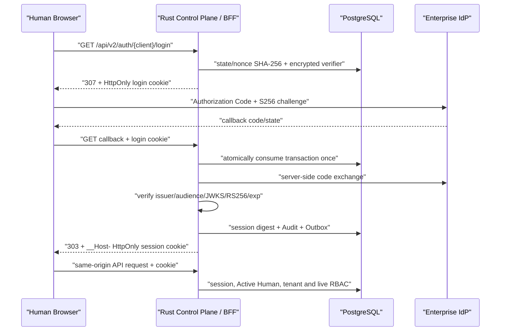

# Human OIDC BFF 会话

> 状态：已实现基础闭环，目标 IdP 互操作、认证强度/Step-up、上游撤销和登录压力验收仍待企业 Pilot。

CopilotMail 的 Admin App 与 Mail App 不再在浏览器 JavaScript 中执行 Token
交换、保存 Access Token 或拼接 `Authorization` Header。浏览器只持有不可读的
opaque Cookie；控制平面作为 BFF 完成 OIDC Authorization Code + S256 PKCE、
企业身份映射、会话创建、实时授权和注销。



## 安全属性

- OIDC Discovery 必须精确匹配配置的 issuer；Authorization、Token、JWKS
  端点必须同源，Provider 必须声明 `code`、S256 PKCE 和公共客户端
  `token_endpoint_auth_method=none`。
- `state` 与独立浏览器 nonce 都至少 256 bit，PostgreSQL 只保存 SHA-256
  摘要。PKCE verifier 使用部署提供的 32 字节 AES-256-GCM 密钥加密，state
  摘要作为 AAD；明文 verifier、authorization code 和 Provider Token
  不进入数据库、审计、前端状态或应用日志。
- Token Endpoint 禁止重定向，响应流限制为 64 KiB；拒绝 Refresh Token 和
  `offline_access`。会话上限取“已验证 JWT `exp`、部署 TTL、8 小时硬上限”
  三者最小值。
- 生产 Cookie 为 Host-only `__Host-` Cookie，不设置 `Domain`。登录关联
  Cookie 使用 `HttpOnly; Secure; SameSite=Lax`；登录后的 Session Cookie
  使用 `HttpOnly; Secure; SameSite=Strict`。
- Session Token 至少 256 bit，PostgreSQL 只保存 SHA-256。每次请求都重新
  检查会话过期/撤销、Active Human、租户一致性和实时 RBAC；生产配置拒绝
  Human Bearer 降级路径。
- 非安全方法必须携带与该 Session 客户端完全一致且唯一的 `Origin`。
  Cookie 与任意 `Authorization` Header 同时出现时按身份歧义拒绝。
- Admin 与 Mail Session 是不同客户端边界：邮件客户端不能调用管理/合规
  API，管理客户端不能借管理会话读取正文或写信。Agent 继续使用独立的短期
  OAuth/mTLS Bearer，不接受浏览器 Cookie。
- 登录、回调、Session 查询与注销都显式携带 `{client}` 路径段；Admin 与
  Mail 分别使用 `__Host-copilotmail-admin-*` 和
  `__Host-copilotmail-mail-*` Cookie。路径客户端、Cookie 客户端或业务路由
  客户端任一不一致即拒绝。
- 登录事务只能消费一次；会话创建、注销与对应 Audit/Outbox 在同一数据库
  事务提交。过期且没有形成 Session 的 pre-auth 记录可受控、有界回收；
  已形成 Session 的证据和会话撤销保持追加式不可变。
- `/api/v2/auth/*` 的所有响应必须带 `Cache-Control: no-store` 和
  `Referrer-Policy: no-referrer`。随回调查询串出现的 code/state 不得进入
  反向代理访问日志或错误日志。

## IdP 注册

Admin 与 Mail 使用独立公共客户端。分别登记精确回调：

```text
https://admin.company.example/api/v2/auth/admin/callback
https://mail.company.example/api/v2/auth/mail/callback
```

必须启用 Authorization Code 与 S256 PKCE，禁止 Client Secret、Implicit 和
Password Grant。所请求 Scope 必须让 IdP 签发 audience 为
`COPILOTMAIL_OIDC_AUDIENCE` 的 RS256 JWT Access Token；仅有 UserInfo audience
的 Token 会被拒绝。目标 IdP 的 MFA、Conditional Access、`acr`/`amr` 约束和
SCIM 停用 SLA 必须在 Pilot 中单独验收。

## 服务端配置

| 变量 | 含义 |
|---|---|
| `COPILOTMAIL_OIDC_ISSUER` | 企业 OIDC issuer |
| `COPILOTMAIL_OIDC_AUDIENCE` | 控制平面 Access Token audience |
| `COPILOTMAIL_ADMIN_OIDC_CLIENT_ID` | Admin 公共客户端 ID |
| `COPILOTMAIL_ADMIN_PUBLIC_ORIGIN` | Admin 精确 HTTPS Origin |
| `COPILOTMAIL_ADMIN_OIDC_SCOPE` | Admin 请求 Scope |
| `COPILOTMAIL_MAIL_APP_OIDC_CLIENT_ID` | Mail 公共客户端 ID |
| `COPILOTMAIL_MAIL_APP_PUBLIC_ORIGIN` | Mail 精确 HTTPS Origin |
| `COPILOTMAIL_MAIL_APP_OIDC_SCOPE` | Mail 请求 Scope |
| `COPILOTMAIL_HUMAN_SESSION_ENCRYPTION_KEY_FILE` | 只读挂载的 32 字节二进制密钥 |
| `COPILOTMAIL_HUMAN_SESSION_TTL_SECONDS` | 300–28800 秒 |
| `COPILOTMAIL_HUMAN_LOGIN_REQUESTS_PER_MINUTE` | PostgreSQL 强制的跨副本登录开始硬上限；Admin 与 Mail 分别计数，范围 1–100000，默认 600 |
| `COPILOTMAIL_REQUIRE_HUMAN_AUTH` | 生产必须为 `true` |
| `COPILOTMAIL_REQUIRE_HUMAN_SESSION` | 生产必须为 `true` |

生产只接受 HTTPS Origin。仅本机开发可显式设置
`COPILOTMAIL_HUMAN_SESSION_ALLOW_INSECURE_COOKIE=true`，且 HTTP Origin
必须是 `localhost`、`127.0.0.0/8` 或 `::1`。
Admin 与 Mail Origin 必须使用不同 Cookie Host；端口不能隔离 Cookie。开发时可分别
使用 `http://127.0.0.1:8083` 与 `http://localhost:8084`。配置层会拒绝同 Host
的两套 Origin，避免浏览器同时携带两个身份 Cookie。

生成开发密钥时不要把内容打印到终端：

```bash
umask 077
head -c 32 /dev/urandom > deploy/secrets/human-session.key
```

使用 `deploy/compose.human-session.yaml` 覆盖层只读挂载该文件。生产应由
Secrets Manager 或编排器提供，轮换需使所有 BFF 实例原子切换；切换期间尚未
完成的登录事务应重新开始。

## 浏览器与反向代理

两套 SPA 必须与各自 `/api` 代理同源，运行时 `apiBaseUrl` 只能为空或同源
绝对路径。反向代理必须：

- 对 `/api/v2/auth/{admin|mail}/{login|callback}` 关闭包含查询串的访问和
  错误日志；
- 保留 `Set-Cookie`、`Location`、`Cache-Control` 与 `Referrer-Policy`；
- 在公网入口终止受信 HTTPS，不得把生产 Session 暴露到明文 LAN；
- 对公开登录入口再施加边缘速率限制和连接并发限制；数据库限流是最后一道
  跨副本保护，不替代边缘防护。

## 验收

至少执行：

1. 两个客户端分别完成登录、刷新页面、注销并确认下一请求为 `401`。
2. 回放 state、错 nonce、错 callback client、过期 transaction 均拒绝，且
   Token Endpoint 未被多次调用。
3. 数据库中搜索原始 state、nonce、Session Token、Access Token 均无结果。
4. Mail Session 调管理/合规 API、Admin Session 调正文/草稿/发送 API 均拒绝。
5. Cookie 加任意 Authorization 组合、缺失/重复 Origin、跨站写请求均拒绝。
6. 超过登录窗口上限返回 `429` 且不新增 transaction；过期未成会话记录可
   有界清理，已成会话证据不可 UPDATE/DELETE/TRUNCATE。
7. 停用 Human、撤销角色或注销 Session 后立即生效；创建/撤销 Audit 与
   Outbox 精确对账。
8. 反向代理、OTLP 和 JSON 日志中不存在 code、state、Cookie、Token 或 PKCE
   verifier。

## 当前边界

- 尚未实现 IdP Back-Channel Logout、安全事件接收和“撤销该 Principal
  所有设备会话”；因此 Session TTL 应保持短，SCIM 停用必须满足公司 SLA。
- 尚未把已验证的 `acr`、`amr`、`auth_time` 写入 Session 并对高危操作执行
  Step-up；企业 Pilot 前不能宣称达到公司指定 AAL。
- 匿名失败登录的独立安全账本、设备列表和全设备注销仍待后续增量；不得把
  原始 OAuth 参数写入普通审计详情作为替代。
- 整个业务审计链对 Session ID 的统一传播仍需继续补齐；当前已覆盖 Session
  创建和撤销本身。

相关决策见 [ADR 0035](adr/0035-human-oidc-bff-session.md)，接口见
[OpenAPI V2](openapi-v2.yaml)，整体剩余风险见
[企业威胁模型](THREAT_MODEL.zh-CN.md)。
