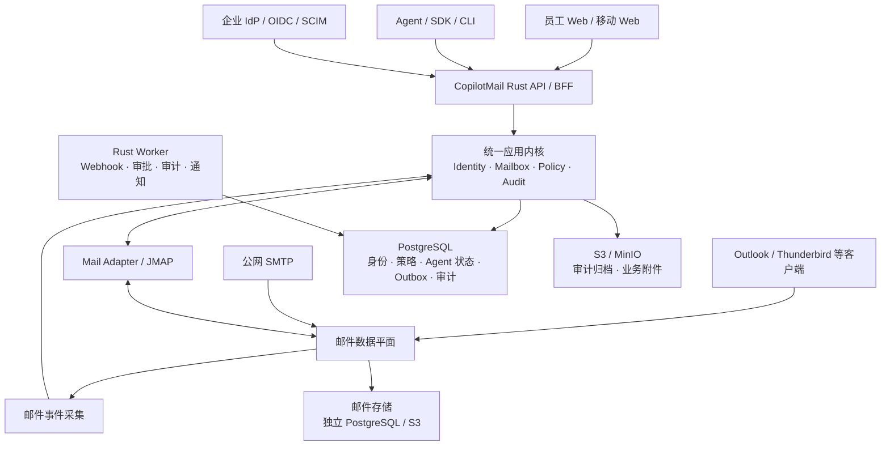

# CopilotMail 企业级实施计划

> 文档状态：Draft
> 目标版本：CopilotMail V2 / Enterprise GA
> 核心原则：统一邮件内核、统一身份与权限模型、人类与 Agent 两套交互语义、企业级审计控制平面

> **2026-09-19 最新范围**：保留 Human Mail、Agent Mail、企业管理和既有 API，先完成代码，
> 不部署；验证码由业务应用处理，邮件系统通过标准 SMTP/IMAP 支持应用发信及外部客户端。
> 当前顺序、模块化、事务与质量门禁以 [当前代码开发范围](CODE_DEVELOPMENT_SCOPE.zh-CN.md)
> 为准。[此前托管验证码方案](APPLICATION_VERIFICATION_API_PLAN.zh-CN.md) 已撤回。
> 本文件的原 P0–P7 企业长期目标保留；原工期估算不作为本次代码开发的承诺。

## 1. 规划结论

CopilotMail V2 不应继续在现有单进程 MVP 上堆叠补丁，而应在同一仓库中建设新的企业级架构：

- 保留 Rust、Tokio、Axum、tracing 等技术方向。
- 保留当前邮件收发、Agent Skill、OpenAPI 和端到端测试所表达的产品概念。
- 重构身份、权限、存储、事件、审计、前端和部署体系。
- 公网 SMTP、IMAP、JMAP、队列与反垃圾能力优先交给成熟邮件数据平面。
- CopilotMail 专注企业身份、策略、Agent API、管理审计和人类使用体验。

建议采用：

> 统一邮件内核 + 统一身份与权限模型 + 人类/Agent 两套交互语义 + 企业审计控制平面。

按 7–9 人核心团队估算：

- 内部 Alpha：约 12–14 周。
- 企业 Beta：约 24–28 周。
- 企业 GA：约 32–36 周。
- 若核心团队少于 6 人，建议按 9–12 个月规划。

## 2. 目标架构



### 2.1 技术选型

| 领域 | 建议 |
|---|---|
| 核心后端 | Rust、Tokio、Axum、Cargo Workspace |
| 数据访问 | PostgreSQL + 版本化 migration；优先显式 SQL/SQLx |
| 邮件数据平面 | 优先 PoC 验证 Stalwart；失败则通过 adapter 切换 Postfix/Dovecot/Rspamd |
| 原始邮件/大附件 | S3 兼容存储；Docker 环境使用 MinIO |
| 前端 | React + TypeScript + Vite；邮件端与管理端共享设计系统 |
| 人员身份 | 公司 OIDC SSO；SCIM 同步用户、部门、群组 |
| Agent 身份 | OAuth2 Client Credentials、`private_key_jwt`、mTLS 或工作负载身份 |
| 内部事件 | PostgreSQL Transactional Outbox；首版不强制引入 Kafka/NATS |
| 外部事件 | 签名 Webhook + Cursor 补拉 + SSE |
| 契约 | OpenAPI 3.1 + AsyncAPI/事件 Schema |
| 可观测性 | OpenTelemetry、Prometheus 指标、结构化日志 |
| 部署 | 多阶段 Docker 镜像、Compose 开发/单节点部署、HA 部署参考 |

Stalwart 适合作为首选候选，是因为它已经提供 SMTP、IMAP、JMAP、Docker、PostgreSQL/S3 后端、队列和 Webhook，而不是要求 CopilotMail 继续扩展当前手写 SMTP 状态机：

- [Stalwart Docker 文档](https://stalw.art/docs/install/platform/docker/)
- [Stalwart JMAP 文档](https://stalw.art/docs/http/jmap/)
- [Stalwart PostgreSQL 后端](https://stalw.art/docs/storage/backends/postgresql/)
- [Stalwart Webhook 文档](https://stalw.art/docs/telemetry/webhooks/)

P0 阶段必须验证其许可证、企业支持、审计事件覆盖、升级策略和 HA 能力。CopilotMail 只能通过公开协议或 API 与邮件数据平面交互，不得依赖其内部表结构。

## 3. 人与 Agent 的双第一公民模型

系统不为人与 Agent 建立两份割裂的消息数据，而是统一 `Principal`、`Mailbox`、`Message`，并分离各自的操作状态。

| 领域 | 人类逻辑 | Agent 逻辑 |
|---|---|---|
| 身份 | OIDC SSO、MFA、浏览器安全 Session | 短期机器 Token、Scope、mTLS、凭据轮换 |
| 邮箱 | 个人、共享、委托、群组邮箱 | Agent 专属、工作流、共享处理邮箱 |
| 消息状态 | 已读、星标、标签、文件夹、草稿 | Cursor、Claim/Lease、Ack/Nack、死信 |
| 收信 | UI 实时更新、桌面通知、IMAP/JMAP | 签名 Webhook、SSE、Cursor 补拉 |
| 发信 | 撰写、回复、转发、自动保存草稿 | `Idempotency-Key`、异步状态、结构化错误 |
| 委托 | 共享邮箱、代表发送 | 明确 `on_behalf_of`、有效期、范围和责任人 |
| 防护 | 外部收件人提醒、附件扫描 | 域名白名单、额度、审批、自动回复熔断 |
| 审计 | 用户、会话、设备 | Agent、Credential、Owner、实际调用者 |

### 3.1 统一身份对象

```text
Principal
  kind = human | agent | service
  status = draft | active | suspended | retired
  organization_id
```

统一核心对象包括：

- Organization、OrgUnit、Domain。
- Principal、HumanProfile、AgentProfile。
- Team、Group、Membership。
- Mailbox：human、agent、shared、group。
- Alias、Credential、Delegation。
- RoleAssignment、Policy。
- Message、Thread、DeliveryAttempt。
- EventSubscription、AgentDelivery。
- AuditEvent。
- RetentionPolicy、LegalHold、ComplianceCase。

### 3.2 状态隔离

- `human_message_state`：已读、星标、标签、归档等。
- `agent_processing_state`：订阅者、游标、Lease、Ack、尝试次数和最后错误。
- `actor`：实际执行操作的身份。
- `subject`：被操作的资源或邮箱。
- `on_behalf_of`：是否代表某个人、团队或 Agent 执行。

员工查看邮件不能导致 Agent 误判为任务已处理；不同 Agent 订阅者之间也不能共享同一个全局处理状态。

### 3.3 人员身份

- 企业用户默认通过 OIDC SSO 登录。
- MFA、设备可信度和登录风险由企业 IdP 管理。
- 使用 SCIM 同步人员、部门、群组和停用状态。
- 企业部署不保留普通本地密码。
- 仅保留严格保护的 Break-glass 账户，其每次使用均触发告警和审计。
- 浏览器使用 HttpOnly、Secure、SameSite Cookie，不将长期 Bearer Token 暴露给前端脚本。

### 3.4 Agent 身份

生产 Agent 不复用人员 Token，不使用长期静态 API Key。

优先级：

1. OAuth2 Client Credentials + `private_key_jwt`。
2. mTLS 客户端证书。
3. Kubernetes 或云工作负载身份映射。
4. 仅开发环境允许短期测试密钥。

Agent 凭据需要支持：

- 创建时仅显示一次。
- 双凭据重叠轮换。
- 立即吊销。
- 到期提醒。
- 最后使用时间和来源。
- 异常使用告警。
- Owner/Sponsor 和定期权限复核。

### 3.5 Agent 专用接口

第一阶段至少提供：

- 获取邮箱元数据。
- 按 Cursor 拉取新消息。
- 获取规范化文本、HTML、附件元数据和认证结果。
- 按需获取原始 MIME。
- 发送、回复和转发。
- 查询投递状态。
- 创建和管理事件订阅。
- Claim/Lease 消息。
- Ack、Nack 和延长 Lease。
- 查询失败和死信。
- 重放指定 Cursor 范围。
- 查询自身额度、权限和策略限制。

所有 Agent 写接口必须支持：

- `Idempotency-Key`。
- 稳定资源 ID。
- `trace_id` / `correlation_id`。
- 机器可读错误码。
- 速率限制响应头。
- 明确的同步接受和异步投递状态。
- API 版本和弃用周期。

Webhook 必须使用至少一次投递语义，并具备签名、时间戳、重试、死信、密钥轮换、人工重放和 Cursor 补拉能力。

### 3.6 Agent 安全护栏

- 内外部收件域白名单或策略。
- 单位时间发信量、同一地址频率、收件人数和附件大小限制。
- 外发、批量、敏感附件和首次联系人可触发人工审批。
- 高风险 Agent 可限制为只生成草稿。
- 识别 `Auto-Submitted` 等自动邮件标记。
- Agent-to-Agent 自动回复循环检测、重复正文检测和熔断。
- 测试环境邮件禁止意外投递到公网。

## 4. 真实域名邮件收发方案

邮件中继端口 25 与认证提交端口 587 必须分离。实现依据为 [RFC 6409](https://datatracker.ietf.org/doc/html/rfc6409)。

### 4.1 入站链路

1. 公网 TCP/25 接收邮件。
2. 校验域名、收件人、连接限制和消息大小。
3. 执行 STARTTLS、SPF、DKIM、DMARC 和反向 DNS 检查。
4. 执行反垃圾、钓鱼、病毒和附件扫描。
5. 持久化原始 MIME。
6. 写入邮件索引和事件。
7. 仅在持久化完成后返回 `250 Queued`。
8. 隔离邮件不得直接暴露危险附件。

### 4.2 出站链路

1. 人或 Agent 提交邮件。
2. 校验 Send As、代表关系、收件域、配额和审批策略。
3. 生成标准 MIME 并执行 DKIM 签名。
4. 写入持久队列。
5. 根据域名策略选择 Direct MX 或企业 SMTP Relay。
6. 对 4xx 延迟重试；对 5xx 或超期状态生成 DSN/退信。
7. 记录每个收件人的独立投递状态。
8. 推送 `delivered`、`deferred`、`bounced` 等事件。

### 4.3 域名接入清单

- 邮件主机 A/AAAA。
- 主域 MX。
- 固定公网出站 IP。
- PTR/rDNS，且正反向解析一致。
- SPF。
- 2048 位 DKIM。
- DMARC：先使用 `p=none` 收集报告，再逐步提升到 `quarantine` 和 `reject`。
- TLS 证书。
- `postmaster@`、`abuse@`。
- MTA-STS 与 TLS-RPT。
- 云厂商允许入站和出站 TCP/25。

Google 当前要求发送方具备 SPF/DKIM、正反向 DNS、TLS 和合规邮件格式；大量发送还要求 DMARC 与域对齐，参考 [Google 发件人指南](https://support.google.com/mail/answer/81126)。

MTA-STS 用于降低 SMTP STARTTLS 被降级或 MX 被劫持的风险，参考 [RFC 8461](https://datatracker.ietf.org/doc/html/rfc8461)。

### 4.4 域名上线策略

1. 使用 `pilot-mail.company.com` 等试点子域。
2. 验证 DNS、TLS、SPF、DKIM、DMARC。
3. 使用少量人员和 Agent 进行内外部收发。
4. 测试 Gmail、Outlook、QQ、163 等外部目标。
5. 观察退信、延迟、垃圾邮件率和 DMARC 报告。
6. 域名切换前降低 MX TTL。
7. 采用灰度用户或邮件路由逐步迁移。
8. 保留明确回滚路由，避免旧系统和新系统形成分裂邮箱。

出站同时实现 Direct MX 和 Smart Host adapter。如果固定 IP、PTR、25 端口或 IP 信誉暂不具备，则先使用企业邮件 Relay。

### 4.5 域名验收标准

- 系统不构成 Open Relay。
- SPF、DKIM、DMARC 全部通过。
- 主要测试目标可正常收发并正确产生退信。
- 远端 4xx 自动重试，进程重启后队列不丢失。
- SMTP 返回 `250` 后，即使立即杀死服务也不丢信。
- MX 指向私网、回环或链路本地地址时禁止连接。
- 域名管理后台持续检查 DNS、证书和认证状态。

技术验收以对端接受、身份认证通过和投递状态可追踪为准，不承诺所有外部邮箱均进入收件箱。

## 5. 企业管理与审计系统

### 5.1 管理后台信息架构

一级导航控制在七项以内：

1. 概览。
2. 企业目录。
3. 邮件与域名。
4. Agents。
5. 策略与审批。
6. 安全与审计。
7. 系统与运维。

主要能力：

- 域名健康、投递成功率、队列、异常发信和安全告警。
- 员工、Agent、团队、群组和组织单元管理。
- 邮箱、共享邮箱、别名、路由和隔离区管理。
- Agent Owner、Scope、凭据、Webhook、额度和调用记录管理。
- RBAC、ABAC、委托、外发、审批、保留和 DLP 策略。
- 审计检索、导出、告警、合规案件和 Legal Hold。
- 运行状态、版本、备份、集成和功能开关。

### 5.2 权限体系

采用 RBAC + ABAC，默认拒绝。至少区分：

- Org Owner。
- Mail Admin。
- Security Admin。
- Compliance Auditor。
- Content Reviewer。
- Helpdesk。
- Agent Operator。
- Employee。
- Break-glass。

邮件管理员默认不能阅读员工正文。读取他人邮件正文必须进入单独合规入口，绑定案件、原因、工单和审批。

高风险操作包括：

- Send As。
- Send On Behalf Of。
- 正文合规访问。
- 审计导出。
- 权限提升。
- Legal Hold。
- Break-glass。
- 批量删除。

这些操作应支持双人审批。

### 5.3 审计范围

必须覆盖：

- 登录、失败、登出、Session 和 Token 吊销。
- 人员、Agent、邮箱、别名和群组生命周期。
- Agent 凭据创建、轮换和停用。
- 角色、Scope、委托和策略变更。
- 邮件发送、读取、删除、恢复和导出。
- Send As、On Behalf Of。
- 域名、DNS、DKIM、路由和配额变更。
- 投递、退信、隔离和人工释放。
- Webhook 创建、禁用和重放。
- 审计查询和导出本身。
- Break-glass、备份恢复和系统配置变更。

审计日志默认不保存邮件正文、附件、密码、Token 或 Secret。

### 5.4 审计字段

每条事件至少包含：

- `event_id`。
- 服务端发生时间和接收时间。
- `organization_id`、环境和区域。
- `actor`、`actor_type`。
- `subject`、`on_behalf_of`。
- action、resource type/id、outcome。
- 操作前后脱敏 Diff。
- `request_id`、`trace_id`。
- 来源 IP、设备、客户端或工作负载。
- Token `jti`、Credential ID。
- 命中的策略 ID、版本和原因。
- Message ID、Mailbox ID。
- 审批或工单 ID。
- 前一事件 Hash、当前 Hash、签名批次 ID。

### 5.5 防篡改设计

- 业务操作与审计 Outbox 在同一个 PostgreSQL 事务内完成。
- 独立消费者写入 append-only 审计表。
- 应用数据库角色无权 UPDATE/DELETE 审计记录。
- 按组织和时间窗口建立 Hash Chain 或 Merkle Root。
- 使用 KMS 中的非对称密钥签署 checkpoint。
- 定期归档到支持 Object Lock/WORM 的对象存储。
- 导出包含查询条件、导出者、Manifest、文件 Hash 和签名。
- 提供离线完整性校验工具。
- 对接 SIEM，并继续审计 SIEM 导出行为。
- 审计系统异常时，高风险操作 Fail Closed；普通读取写入持久缓冲并立即告警。

审计验收标准：

- 所有特权状态变更 100% 产生审计事件。
- 正常情况下 30 秒内可查询。
- 任意删除、修改、乱序或缺失均可由校验工具发现。
- 审计查询和导出行为本身继续进入审计链。

## 6. 代码架构与现有项目迁移

采用模块化单体代码库、按职责拆分运行进程，首版不引入大量业务微服务。

```text
apps/
  api/
  worker/
  audit-ingest/
  ctl/
  migrate/

crates/
  domain/
  application/
  contracts/
  identity/
  mailbox/
  policy/
  audit/
  adapter-postgres/
  adapter-mail/
  adapter-object-store/
  adapter-identity/
  interface-http/
  platform/

web/
  mail-app/
  admin-app/
  design-system/

docs/
  adr/
  architecture/
  api/
  operations/
  security/
  user-guide/
```

### 6.1 依赖规则

- `domain` 不依赖 Axum、SQLx、HTTP 或邮件服务器实现。
- 用例位于 `application`，接口层不写业务规则。
- adapter 实现 application 定义的端口。
- Stalwart/Postfix、PostgreSQL、S3 和 OIDC 均可替换。
- binary 仅负责配置读取和依赖组装。
- 仅在真实系统边界抽象 trait，避免过度设计。
- 公共 Rust API 使用 Rustdoc。
- 复杂代码注释解释约束、原因和不变量，不重复翻译代码。
- 每个关键架构决策形成 ADR。
- CI 检查模块依赖、契约、数据库迁移和文档。

### 6.2 数据分工

CopilotMail PostgreSQL 存储：

- 企业目录、Principal、Agent Profile。
- 权限、角色、委托和策略。
- Agent Cursor、Lease、Ack 和 Webhook 状态。
- 审批、Outbox、审计和合规案件。
- 域名配置和邮件数据平面的稳定外部 ID 映射。

邮件数据平面存储：

- 邮件、文件夹、线程、Flags。
- 原始 MIME 和附件。
- SMTP/IMAP/JMAP 状态。
- 邮件投递队列和协议级投递结果。

两个系统使用独立 PostgreSQL database/schema 和独立数据库角色。CopilotMail 不直接修改邮件数据平面的内部表。

### 6.3 现有代码处理

| 当前模块 | 处理方式 |
|---|---|
| Rust/Tokio/Axum/tracing | 保留技术方向 |
| `src/store.rs` | 重写为 PostgreSQL repository 与 migration |
| `src/smtp.rs` | 不再作为公网 MTA；保留为测试夹具和行为参考 |
| `src/outbound.rs` | 由邮件数据平面和持久队列替代 |
| `src/events.rs` | 改为 Transactional Outbox；广播仅作本机优化 |
| `src/api.rs` | 拆为接口、应用、领域和 adapter |
| `web/index.html` | 重写为 TypeScript 应用 |
| 当前 OpenAPI/E2E | 固化为回归基线，再扩展为 V2 契约测试 |
| 当前 Agent Skill | 重写为安全 CLI/SDK，禁止输出 Secret/Token |

建议为当前状态打 `v0.1-prototype` 标签。V2 在同一仓库的新结构中推进；旧 `/v1` 仅在确有使用者时保留短期兼容层。

## 7. 数据模型建议

### 7.1 企业和身份

- `organizations`
- `org_units`
- `domains`
- `principals`
- `human_profiles`
- `agent_profiles`
- `identity_bindings`
- `sessions`
- `credentials`
- `teams`
- `groups`
- `memberships`

### 7.2 权限和策略

- `roles`
- `permissions`
- `role_bindings`
- `delegations`
- `policies`
- `policy_versions`
- `approval_requests`
- `approval_steps`

### 7.3 邮箱与映射

- `mailboxes`
- `mailbox_memberships`
- `aliases`
- `mail_engine_resources`
- `message_references`

### 7.4 Agent 状态

- `agent_subscriptions`
- `agent_message_states`
- `agent_leases`
- `agent_dead_letters`
- `idempotency_keys`

### 7.5 事件和审计

- `outbox_events`
- `webhooks`
- `webhook_deliveries`
- `audit_events`
- `audit_checkpoints`
- `compliance_cases`
- `legal_holds`
- `retention_policies`

统一使用：

- UUIDv7 或等效有序唯一 ID。
- PostgreSQL `timestamptz`。
- 明确的 `organization_id`。
- 乐观锁或版本号。
- 软删除、保留期和最终清理状态。
- Transactional Outbox。

## 8. 前端与低交互成本 UX

前端采用 React + TypeScript SPA。邮件端和管理端共享：

- 设计 Token。
- 表单、表格、对话框和通知组件。
- 权限感知路由。
- 国际化框架。
- 可访问性规则。
- 错误模型和 API Client。

### 8.1 人类邮件端

- SSO 后直接进入收件箱，不做产品内二次登录。
- 桌面端采用简洁三栏或可收起两栏布局。
- 移动端采用列表—详情层级。
- 回复、归档、删除和标记保持在一个操作层内。
- 支持自动保存草稿、快捷键、命令面板和批量操作。
- 明确标识“人类”“Agent”“由 Agent 代表发送”。
- HTML 邮件沙箱渲染，默认禁止远程图片。
- 附件先扫描后开放下载。
- 外部收件人、敏感附件和策略风险在输入阶段提示。
- 共享或委托邮箱切换时始终显示当前发件身份。
- 可以提供短暂撤回发送窗口，但不得暗示已投递邮件可以真正召回。

### 8.2 管理端

- 常用操作一步完成。
- 高风险操作显示影响范围和变更 Diff。
- 批量操作先显示受影响对象数量。
- 策略编辑支持 Dry Run 和样例请求测试。
- 低风险操作不滥用重复确认。
- 高风险操作要求理由、工单或审批。
- 错误信息包含原因、是否可重试和建议下一步。

### 8.3 UX 验收指标

- 从收件箱开始写信不超过一次主操作。
- 回复并发送不超过两个主操作。
- 管理员定位一封邮件的投递轨迹不超过三层导航。
- 新 Agent 从创建凭据到成功收发第一封测试邮件不超过十分钟。
- 首发支持简体中文和英语。
- 核心功能能够完全使用键盘操作。
- 满足 WCAG 2.2 AA。

## 9. Docker 与运行体系

### 9.1 交付内容

- `compose.dev.yaml`：PostgreSQL、MinIO、开发 IdP、测试邮件出口。
- `compose.pilot.yaml`：反向代理、Rust API、Worker、邮件数据平面、PG、MinIO、监控。
- `compose.observability.yaml`：Prometheus、Grafana、日志和 Trace。
- Production Dockerfile：固定版本、多阶段构建、非 root、read-only rootfs。
- 一次性 migration 容器。
- Docker Secrets 或只读挂载文件管理密钥。
- 独立 liveness、readiness 和 dependency health。
- 优雅关停、资源限制、网络隔离。
- 镜像 SBOM、漏洞扫描和签名。

### 9.2 网络边界

对外端口：

- 25：公网 SMTP Relay。
- 587：认证 Message Submission。
- 465：可选隐式 TLS Submission。
- 993：IMAPS。
- 443：Web、API 和 JMAP。

内部端口：

- PostgreSQL。
- MinIO/S3。
- 邮件数据平面管理 API。
- Prometheus metrics。
- OpenTelemetry collector。
- 管理 API。

管理 API 默认只允许 VPN 或零信任网络访问。

### 9.3 高可用边界

Compose 作为开发、试点和单节点部署方案，不能宣称高可用。

正式企业 HA 至少需要：

- 两个及以上 API 实例。
- 两个及以上邮件入口。
- 两个及以上 Worker。
- 冗余 PostgreSQL。
- 冗余对象存储。
- 多 MX 或 TCP 负载均衡。
- 固定出站 IP。
- PostgreSQL PITR/WAL。
- 对象版本化和异地备份。
- 定期恢复演练。

建议初始非功能基线：

- 可用性：99.9%，企业 GA 再评估提升。
- RPO：15 分钟以内。
- RTO：2 小时以内。
- 所有接受邮件均满足 `250` 后不丢失。

具体指标须在 P0 根据公司业务等级确认。

## 10. 详细实施阶段表

| 阶段 | 工期 | 核心工作 | 主要交付物 | 退出验收 |
|---|---:|---|---|---|
| P0 产品、架构与邮件 PoC | 2–3 周 | 明确规模、IdP、合规、旧邮件迁移和 IMAP 需求；对比 Stalwart/备用方案；威胁建模 | PRD、C4、ADR、领域模型、权限矩阵、审计事件目录、UX 原型 | 邮件数据平面选型通过；SLO/RPO/RTO 和范围签字确认 |
| P1 工程底座 | 3–4 周 | Cargo Workspace、PG migration、配置/Secrets、错误模型、Tracing、Docker、CI | 新目录结构、PG/S3 adapter、开发 Compose、质量门禁 | 一条命令启动；迁移可重复；依赖故障能被 readiness 发现 |
| P2 身份、权限与审计骨架 | 4–5 周 | Principal、Human/Agent、OIDC、SCIM、Agent Credential、RBAC/ABAC、Delegation、Outbox | 身份与授权服务、审计基础链路 | 人可 SSO；Agent 使用短期 Scope Token；跨邮箱越权测试全部失败；吊销快速生效 |
| P3 邮件核心与域名 Pilot | 5–7 周 | 集成邮件数据平面、PG/S3、内部路由、公网收发、队列、退信、DNS 向导、垃圾/病毒扫描 | 子域收发、IMAP/Submission、DKIM/SPF/DMARC、投递轨迹 | `250` 后不丢信；重启可恢复队列；域名认证通过；不是 Open Relay |
| P4A 人类邮件体验 | 5–7 周，与 P4B 并行 | 收件箱、会话、搜索、草稿、附件、共享邮箱、委托、i18n、无障碍 | Human Web App | 关键 E2E 通过；核心操作满足交互指标；中英文无硬编码 |
| P4B Agent Mail Platform | 5–7 周，与 P4A 并行 | Agent API、Cursor、Lease、Ack/Nack、Webhook、死信、幂等、SDK、Sandbox、循环保护 | Agent API/SDK/CLI | 幂等请求不重复发信；Webhook 故障后可补拉；凭据可无停机轮换 |
| P5 管理、审计与治理 | 5–6 周 | 企业目录、域名、邮箱、Agents、策略、审批、队列、隔离、审计检索、WORM 归档、SIEM | 管理后台与审计中心 | 管理员默认无法读正文；特权操作 100% 审计；导出可离线验签 |
| P6 硬化、迁移与企业 Pilot | 5–7 周 | 负载、模糊、故障注入、渗透测试、备份恢复、旧邮件导入、MX 灰度切换 | Pilot 报告、迁移工具、运行手册 | 数据与哈希 100% 对账；达到 RPO/RTO；无未处理 Critical/High |
| P7 GA 发布 | 2–3 周 | HA 部署验证、版本升级/回滚、镜像签名、培训、文档和多语言 README | GA 镜像、发布说明、文档站 | 安装、升级、故障和回滚演练全部通过 |

建议里程碑：

- 第 8 周：工程与身份底座完成。
- 第 12–14 周：一个员工与一个 Agent 可在同一邮箱中可靠协作。
- 第 20–22 周：真实子域公网收发 Beta。
- 第 26–28 周：管理审计和企业 Pilot。
- 第 32–36 周：企业 GA。

## 11. 测试与质量门禁

测试体系必须包含：

- 领域单元测试。
- PostgreSQL/S3 集成测试。
- API/OpenAPI 契约测试。
- SMTP/JMAP/IMAP 互操作测试。
- Playwright 人类端 E2E。
- Agent 幂等、Webhook 重试和 Cursor 回放测试。
- 权限负向、跨邮箱、Send As 和管理员正文访问测试。
- MIME、地址和 SMTP 输入模糊测试。
- Open Relay、SSRF、Header Injection 测试。
- 进程崩溃、数据库短暂断开、队列恢复和备份还原测试。
- 外部域名送达种子测试。
- 数据迁移计数、哈希和随机抽样渲染测试。

CI/CD 质量门禁：

- `cargo fmt`、Clippy、单元和集成测试。
- 前端 lint、类型检查、单元和浏览器测试。
- OpenAPI/AsyncAPI lint 与实现契约测试。
- migration 前向和升级测试。
- 依赖漏洞和许可证检查。
- Docker 构建与容器启动测试。
- SBOM、镜像扫描和签名。
- 文档链接、示例命令和多语言结构检查。
- 未通过 Critical/High 安全门禁不得发布。

## 12. 文档与多语言 README

### 12.1 README

- `README.md`：语言选择和项目入口。
- `README.zh-CN.md`：简体中文完整版本。
- `README.en.md`：英文完整版本。
- 后续根据需要增加日语等语言。
- CI 检查多语言章节和链接是否同步。

### 12.2 项目文档

- 产品范围和角色说明。
- 架构说明、C4 图和 ADR。
- 数据模型与状态机。
- 人类 API OpenAPI。
- Agent API OpenAPI。
- 事件和 Webhook AsyncAPI。
- DNS 和域名接入指南。
- Docker 开发、Pilot、单节点和 HA 部署指南。
- 安全模型、权限矩阵和审计事件目录。
- 备份、恢复、升级和回滚 Runbook。
- TLS 证书和 DKIM 密钥轮换 Runbook。
- 管理员、员工和 Agent 开发者手册。
- CONTRIBUTING、SECURITY、CHANGELOG、LICENSE。

## 13. 统一 Definition of Done

每个新增功能只有同时满足以下条件才算完成：

- 明确支持 Human、Agent 或两者，并说明各自状态语义。
- 每个接口经过认证、授权和组织/邮箱边界检查。
- 每个关键行为映射审计事件。
- 日志和审计中不泄露正文、附件、Token 或 Secret。
- 写接口具备幂等、重试或补偿语义。
- API 具备稳定错误模型和关联 ID。
- UI 文案全部国际化。
- 具备单元、集成、权限负向和 E2E 测试。
- 管理操作提供影响预览和回滚或补偿方案。
- OpenAPI/AsyncAPI、管理员文档和用户文档同步更新。
- 具备指标、Trace、告警和故障运行手册。
- 通过无障碍和基础安全检查。

## 14. 首版明确不引入的复杂度

没有明确容量或业务证据前，首版不引入：

- 大量业务微服务。
- Kafka/NATS 作为必需依赖。
- Redis 作为事实来源。
- Elasticsearch/OpenSearch。
- 自研 OIDC Provider。
- 自研完整 SMTP、IMAP 或 JMAP 协议栈。
- 原生移动 App。
- 日历、联系人和文件协作。
- 营销群发平台。
- 多区域 Active-Active。
- 邮件正文端到端加密。

首版采用传输加密、存储加密、严格权限控制、审计和合规访问流程。出现明确容量或合规要求后，通过 adapter 替换基础设施，不修改核心领域模型。

## 15. 启动前需要确认的公司输入

P0 阶段需要确认：

- 员工数、Agent 数、峰值并发、每日邮件量和附件上限。
- 当前邮件系统及历史邮件迁移量。
- 是否必须兼容 Outlook、Thunderbird、Apple Mail。
- 企业 IdP 类型以及是否支持 OIDC/SCIM。
- 主域、可用 Pilot 子域、静态公网 IP、PTR 和 TCP/25 条件。
- 允许 Direct MX、SMTP Relay，还是两者均需支持。
- 邮件和审计保留年限、Legal Hold 和数据驻留要求。
- 目标 SLO、RPO 和 RTO。
- 公司是否已有 KMS/Vault、S3、SIEM 和反病毒能力。
- 首发语言范围；默认建议简体中文与英语。
