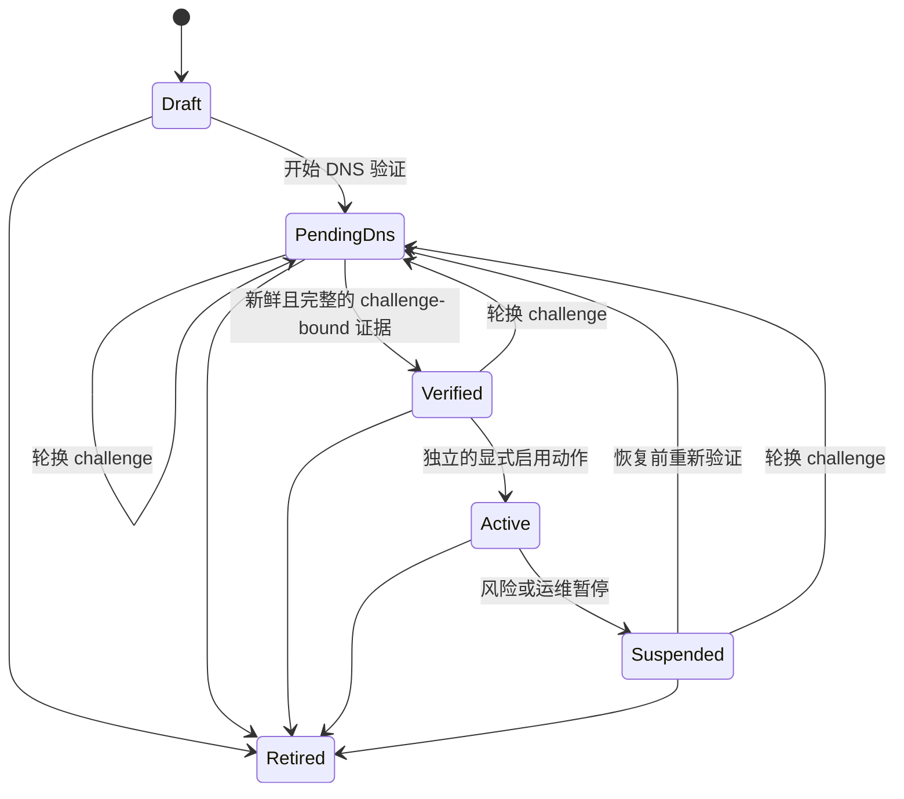

# 邮件域名与 DNS 治理

## 设计原则

域名是企业级安全边界，不是一个可随意修改的字符串。CopilotMail 控制平面拥有域名
归属、验证状态、路由策略和审计上下文；邮件引擎只接收已授权的配置投影。

同一个规范化域名在整个控制平面全局唯一，防止两个租户同时声明同一邮件域。Unicode
域名在领域层按 IDNA 转成小写 Punycode；IP literal、单标签名、空标签、下划线和
非法连字符位置会被拒绝。

## 状态机



DNS 查询成功不会直接启用收发。`Verified → Active` 必须是独立、可授权和可审计的
动作；暂停后的域名也不能直接恢复 Active，必须重新验证。

## DNS 证据

每次观测是不可修改的追加记录，并绑定当前 ownership challenge 的 SHA-256：

- ownership TXT；
- MX 是否存在；
- 所有 MX 解析地址是否均为可路由公网地址；
- SPF；
- DKIM；
- DMARC；
- 原始公开 DNS 答案和稳定失败码；
- 观测时间与不超过 24 小时的证据有效期。

旧 challenge 的结果不能验证新 challenge，过期结果不能激活域名。数据库保存
challenge 摘要，不保存可直接用于接管验证的明文 token。

每个域名同时保存从 1 开始单调递增的公开 challenge 版本号。轮换会以行锁原子替换
摘要、递增版本、清空 `verified_at` 并回到 `pending_dns`；旧摘要绑定的全部历史证据
仍保留用于审计，但不再进入当前状态计算。`active` 域名必须先显式暂停，`retired`
域名永久拒绝轮换，防止在生产收发期间静默转移域名控制权。

`copilotmail-dns` adapter 已对每个 MX 主机完成 A/AAAA 解析，并拒绝 private、
loopback、link-local、unspecified、文档地址、转换地址和其他非公网目标，以防
SSRF 与错误路由。系统 hosts 文件不会参与域名验证，所有查询都使用带尾点的绝对
域名，并受总超时、记录数、TXT 大小、MX 主机数和 TTL 上限约束。DNS adapter
只能产生候选证据，不能自行改变域名状态。

SPF 和 DMARC 必须各有且仅有一条匹配策略；DMARC 必须包含有效的 `p` 策略。
DKIM TXT 会解析实际 RSA DER 公钥并要求至少 2048 位，不以字符串长度冒充密钥
强度。RFC 7505 Null MX 会被识别为“明确不接收邮件”，而不是普通 MX。

可在不连接数据库的情况下执行真实预检。ownership token 只能放在文件中，命令
输出不会包含明文 token：

```powershell
cargo run --locked -p copilotmail-control -- check-domain-dns `
  --domain example.com `
  --ownership-token-file C:\secure\copilotmail-domain-token.txt `
  --dkim-selector mail
```

该命令只输出候选证据，不注册、验证或启用域名。

## 应用事务边界

`MailDomainGovernanceService` 已实现注册、challenge 轮换、记录 DNS 证据、显式激活、
暂停和路由更新六类用例。所有用例先校验实时 `mail.admin` 权限与租户内 Active
Principal，再在单个 PostgreSQL 事务中锁定域名或路由行。

- 注册同时创建 `pending_dns` 域名、默认关闭的路由、审计事件和 Outbox 事件。
- challenge 轮换只接受服务端产生的新摘要，原子递增版本并使旧证据失效；审计和
  Outbox 仅包含非秘密版本信息。
- DNS 证据先校验 challenge 摘要、时间窗口、结构和大小，再追加写入；证据行禁止更新、删除和截断。
- 激活只读取当前 challenge 下按观测时间排序的最新一条证据；旧的合格结果不能覆盖更新但不合格的观测结果。
- 路由更新使用单调版本号和 compare-and-swap，过期的管理页面或 Agent 不能覆盖新配置。
- 暂停域名和关闭入站/出站路由在同一事务提交，任一步冲突都会整体回滚。

域名相关的七类动作已进入迁移管理的审计目录：`registered`、
`challenge_rotated`、`dns_observed`、`verified`、`activated`、`suspended` 与
`route_updated`。审计详情和 Outbox 均不包含 ownership token 明文或摘要。

## Human 与 Agent 共用 API

控制平面提供同一组 `/api/v2` JSON 接口给管理 UI 和 Agent。两者使用相同的 Bearer 认证、实时 Token Scope、`mail.admin` RBAC、租户绑定、错误码和请求 ID，不存在绕过治理服务的“Agent 快速通道”。

- 注册接口由服务端生成高熵 ownership token，只在 `201` 响应中返回一次；数据库、审计和 Outbox 仅保存或传播非秘密信息。
- challenge 轮换接口同样由服务端生成高熵 token，只在成功响应中返回一次；响应
  提供新的 challenge 版本，后续详情只返回版本、不返回 token。请求必须携带读模型
  中的 `expected_version`；同一版本的并发轮换只有一个能够提交，其余返回
  `409 mail_domain_conflict`，避免向调用方返回已被另一请求立即作废的 token。
- DNS 验证接口在认证授权后才进行网络查询，并强制查询域名、域名 ID、租户和 challenge 摘要四者一致。
- 激活、暂停与路由接口分别暴露明确动作；Agent 不需要模拟管理 UI 的多步页面状态。
- 路由请求必须携带 `expected_version`；冲突返回稳定的 `409 mail_domain_conflict`，方便 Human UI 提示刷新，也方便 Agent 安全重读后重试。
- 列表按规范化域名进行稳定游标分页，详情和列表同时返回生命周期、challenge
  版本、路由版本/开关以及当前 challenge 的最新 DNS 观测；跨租户 ID 与不存在资源
  统一为 404。

完整请求/响应和稳定错误契约见 `docs/openapi-v2.yaml`。一次性 token 丢失时调用
`POST /api/v2/mail-domains/{mail_domain_id}/ownership-challenge`；客户端必须立即安全
保存响应 token 并更新 TXT，原 token 无法再次读取。

## 邮件引擎投影状态

域名生命周期状态和邮件引擎同步状态是两条不同的事实。`active` 表示治理动作已经原子提交，不等于 Stalwart 已经接受配置。列表与详情响应额外返回：

| 状态 | 含义 |
|---|---|
| `not_projected` | 尚无需要同步到邮件引擎的生命周期动作 |
| `pending` | 已提交激活/暂停，等待 Worker 同步或正在尝试 |
| `ready` | 最新目标状态已经由邮件引擎确认并记录 |
| `failed` | 最近尝试失败，Outbox 仍未发布并按指数退避重试 |

响应同时包含不透明 Engine ID、引擎实际启停值、最近尝试/成功时间和稳定非秘密错误码。
Worker 在调用引擎前，以之前读取的 `last_attempt_at` compare-and-swap 为新的 attempt
token；成功或失败只在域名生命周期、`MailDataPlaneId` 与该 token 均精确匹配时提交。
因此管理员在网络调用期间改变生命周期时，旧结果不会覆盖新目标；即使生命周期未变，
较慢的并发旧 attempt 也不能覆盖较新的结果。事件会重新读取当前状态后补偿。

## 路由治理

路由配置与域名验证状态分表，并使用单调版本号支持并发控制。支持两种可替换策略：

- `direct_mx`：邮件数据平面直接查询并投递收件方 MX；
- `smart_host`：通过受管 relay 发送。

入站和出站默认都关闭。后续应用服务只有在域名 Active、DKIM key reference 可用、
基础授权通过，并且高风险策略所需审批已满足时，才可启用对应方向；每次变更必须把
业务状态、审计事件和 Outbox 事件放在同一 PostgreSQL 事务提交。

## 标准依据

- [IANA IPv4 Special-Purpose Address Registry](https://www.iana.org/assignments/iana-ipv4-special-registry/iana-ipv4-special-registry.xhtml)
- [IANA IPv6 Special-Purpose Address Registry](https://www.iana.org/assignments/iana-ipv6-special-registry/iana-ipv6-special-registry.xhtml)
- [RFC 7505 Null MX](https://datatracker.ietf.org/doc/html/rfc7505)
- [RFC 6376 DKIM](https://datatracker.ietf.org/doc/html/rfc6376)
