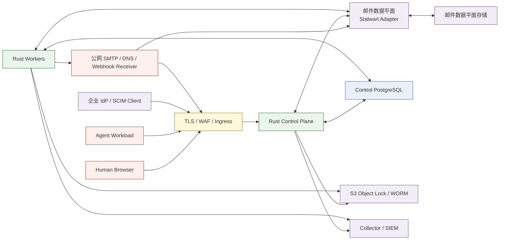

# CopilotMail V2 企业威胁模型

> 状态：P0 安全基线，2026-08-13
> 适用版本：CopilotMail V2 / Enterprise GA 规划
> 口径：只把已有代码、测试或可执行配置记为“已实现”；需要真实 IdP、公网邮件、
> PostgreSQL、Object Lock 或生产网络的项目保持“待验证”。

## 1. 目的与范围

本文把实施计划中的安全原则转化为可追踪的威胁、控制和验证证据。它覆盖：

- Human、Agent 与 Service Principal 的身份和凭据；
- 浏览器、Agent API、SCIM、邮件引擎事件和运维入口；
- 邮件域名、JMAP/SMTP 数据平面及 DNS；
- PostgreSQL、事务型 Outbox、Worker 和对象存储；
- Webhook、SSE、审计检索、导出、WORM 与 Legal Hold；
- Docker、Secret、遥测、备份恢复和供应链。

V1 手写 SMTP 仅作为回归原型，不在生产信任边界内。生产邮件协议和存储由可替换的
邮件数据平面承担，CopilotMail 只通过公开协议或 API 与其交互。

本文不是合规认证，也不替代生产渗透测试。公司规模、司法辖区、数据驻留、
RPO/RTO、目标 IdP、邮件量和风险接受人尚未签字前，P0 不能标记完成。

## 2. 安全目标与不可破坏约束

1. **租户隔离**：认证得到的组织必须与目标资源组织精确一致；未知、缺失或冲突信息
   一律拒绝。
2. **最小权限**：实时 Token Scope、RBAC 与资源级 ABAC 必须同时满足；审批只能
   收窄权限，不能创造权限。
3. **主体可归责**：Human、Agent、Service、Credential、Owner、代表主体和实际调用者
   必须可区分，不接受由请求正文伪造的主体。
4. **内容最小暴露**：审计、日志、Outbox、Webhook 和遥测默认不包含正文、MIME、
   附件内容、密码、Token 或 Secret。
5. **关键证据原子性**：特权状态变更与 Audit + Outbox 在同一 PostgreSQL 事务提交；
   证据失败时状态变更失败。
6. **不可变与可验证**：审批步骤、授权凭证、下载账本、投递证据和审计记录不可更新
   或删除；哈希链、签名 Checkpoint 和 Object Lock 用于发现数据库权限之外的篡改。
7. **精确重放**：重试只能复用同一租户、主体、资源、版本和请求摘要；歧义结果进入
   对账或人工复核，不能盲目重复发送。
8. **外部输入不可信**：DNS、IdP metadata、邮件引擎事件、JMAP 响应、Webhook
   Endpoint、HTTP Header、Cursor 和对象 metadata 均需限定长度、类型、来源和时效。
9. **撤销在线生效**：高风险入口不能只相信 Token 中的旧权限；必须检查 Active
   Principal、实时角色/委托/凭据状态和有效期。
10. **高风险默认拒绝**：可信认证、审批、审计、对象版本、远端回读或关键依赖不可用
    时，不以降级方式执行高风险动作。

## 3. 信任边界与数据流

### 3.1 边界说明

| 边界 | 允许的信任 | 明确不信任 |
|---|---|---|
| Browser → Edge/API | IdP 签发且由服务端验证的短期 Access Token | 浏览器状态、路径组织 ID、隐藏字段、Local Storage |
| Agent → Edge/API | 短期 Scope Token；可选原生 mTLS 绑定 | Agent 自报 Owner、邮箱、租户或代表主体 |
| SCIM → API | 独立租户 SCIM Bearer 摘要与固定租户绑定 | SCIM Payload 中的组织归属和权限 |
| Mail Engine → API | 独立 Bearer + 原始 Body HMAC；已登记 Account 映射 | 来源地址、主题、Header 或时间启发式租户归属 |
| API/Worker → Mail Engine | 固定 Origin、专用能力 Token、精确 Account/ID | 引擎内部数据库结构、模糊搜索结果 |
| Worker → Webhook | HTTPS、解析后的公网地址、签名事件允许列表 | Redirect、私网/回环/链路本地地址、任意 Payload |
| API/Worker → PostgreSQL | 最小权限连接、显式事务、租户条件 | 数据库行自身等同于外部可信锚 |
| API/Worker → S3 | 精确 Key + Version ID + 长度 + SHA-256 回读 | `latest` 对象、调用者提供的 Key/Version/摘要 |
| API/Worker → OTel/SIEM | 有界、脱敏、稳定字段 | 任意 Header、Query、错误正文、邮件内容或 Secret |

## 4. 资产与攻击者

### 4.1 关键资产

| 资产 | 机密性 | 完整性 | 可用性 |
|---|---:|---:|---:|
| 邮件正文、附件和地址关系 | Critical | High | High |
| Human/Agent 凭据、签名私钥和 SCIM Token | Critical | Critical | High |
| 租户、Principal、角色、委托和审批状态 | High | Critical | High |
| 邮件域名、DKIM、路由和投递状态 | High | Critical | Critical |
| 审计链、Checkpoint、归档和 Legal Hold | High | Critical | High |
| Outbox、Lease、Cursor 和幂等状态 | Medium | Critical | High |
| 配置、Secret、备份和恢复材料 | Critical | Critical | Critical |

### 4.2 攻击者与失效主体

- 未认证公网攻击者、垃圾邮件发送者和恶意收件方。
- 被入侵或越权的员工、管理员、审计员或审批人。
- 被入侵、提示注入或配置错误的 Agent。
- 泄露的浏览器 Token、Agent 私钥、SCIM Token 或邮件引擎 Secret。
- 恶意或失陷的 Webhook Receiver、DNS 响应方、IdP、邮件引擎或对象存储凭据。
- 具有数据库、容器宿主、CI 或备份访问权的内部人员。
- 网络分区、重复事件、时钟偏移、进程崩溃、并发 Worker 和部分成功故障。

## 5. 威胁—控制—证据矩阵

状态含义：

- **已实现**：存在生产路径代码和自动化验证。
- **部分实现**：边界代码存在，但缺少真实环境、容量或故障演练。
- **未实现**：进入实施队列，不能在部署说明中宣称受控。

| ID | 威胁 / STRIDE | 初始风险 | 当前控制 | 状态与证据 | 剩余工作 |
|---|---|---:|---|---|---|
| ID-01 | 伪造 Human 身份、跨租户 Token 或路径租户混淆 / S,E | Critical | OIDC Discovery/JWKS、Issuer/Audience/Alg 限定；认证租户与资源租户精确比较；未知映射拒绝 | 已实现：[OIDC ADR](adr/0004-enterprise-human-oidc.md)、[授权矩阵](AUTHORIZATION_MATRIX.zh-CN.md) | 目标 IdP 互操作、MFA/条件访问和停用 SLA 演练 |
| ID-02 | Bootstrap 或首位 Owner 接管被劫持 / S,E | Critical | 离线 Bootstrap；OIDC Owner 原子接管并永久退休 Bootstrap Service | 已实现：[Owner Handover ADR](adr/0005-oidc-owner-handover.md) | 生产接管 Runbook、双人见证和恢复演练 |
| ID-03 | Agent Assertion 重放、私钥泄露或旧凭据继续使用 / S,R,E | Critical | `private_key_jwt`、短窗口、`jti` 摘要单次消费、Scope 交集、重叠轮换、立即撤销、可选原生 mTLS 绑定 | 已实现：[Agent 认证](AGENT_AUTH.zh-CN.md) | SPIFFE/云工作负载身份、KMS/HSM 和异常速率告警 |
| ID-04 | Human OAuth 参数/Token/Session 被窃取、登录事务重放、客户端混淆或公开登录写放大 / S,I,D,E | Critical | 服务端 Code+S256 PKCE；state+浏览器 nonce 双绑定并单次消费；摘要/AEAD 持久化；Host-only HttpOnly Secure Strict Session；Origin CSRF；Admin/Mail 路由隔离；跨副本登录 admission 与过期 pre-auth 有界回收；敏感回调不落代理请求日志 | 部分实现：[Human OIDC BFF 会话](HUMAN_OIDC_SESSION.zh-CN.md)、[ADR 0035](adr/0035-human-oidc-bff-session.md) | 目标 IdP 互操作、`acr/amr/auth_time` 与 Step-up、Back-Channel Logout、安全事件、边缘限流和浏览器攻击 E2E |
| AUTH-01 | 请求正文伪造 actor/tenant/owner/on_behalf_of / S,E | Critical | 主体来自认证上下文；命令不接受治理字段；实时 RBAC + Scope + ABAC | 已实现：契约 `deny_unknown_fields` 与未认证 Fail Closed 测试 | 属性模糊与公开渗透仍未做。2026-10-12 离线负向测试覆盖未知字段、类型混淆、整数边界，以及注入失败且错误不回显载荷 |
| AUTH-02 | 审批被转让、跨资源复用、自审或单人提权 / R,E | Critical | 不可变策略版本、原申请人绑定、精确 Action/Resource、独立双人审批、有效期 | 已实现：[审批工作流](APPROVAL_WORKFLOW.zh-CN.md) | SCIM Group/职责规则、通知、SLA 与策略 Dry Run |
| AUTH-03 | 角色授予扩大机器权限或撤销最后 Owner / E,D | Critical | 限时授权、双人权限提升审批、Agent 仅 Agent Operator、最后有效 Owner 保护、不可变授权账本 | 已实现：[授权矩阵](AUTHORIZATION_MATRIX.zh-CN.md) | 自定义角色的安全编辑模型和真实 PG 并发负向执行 |
| MAIL-01 | Open Relay、Header/命令注入、伪造 From / S,T,I | Critical | 地址规范化、控制字符拒绝、From 服务端派生、Mailbox Send ABAC；V1 不作为生产 MTA | 部分实现：[Human 邮件端边界](HUMAN_MAIL_APP.zh-CN.md) | 真实 SMTP Open Relay、Header Injection、SPF/DKIM/DMARC 测试 |
| MAIL-02 | 响应丢失或并发租约导致重复发送 / R,T | Critical | Frozen Draft、持久 Intent、查询优先、精确 Submission 对账、Lease 接管、歧义人工复核、终态原子证据 | 已实现代码边界：[Submission ADR](adr/0027-recoverable-idempotent-mail-submission.md) | 公网延迟、Worker 崩溃、DSN 和重复投递演练 |
| MAIL-03 | HTML、远程图片或恶意附件攻击 Human / I,E | Critical | 当前只返回有界 `text/plain`，不渲染 HTML、不暴露 Blob ID | 部分实现：[Human 邮件端边界](HUMAN_MAIL_APP.zh-CN.md) | HTML 沙箱、远程图片代理/默认关闭、恶意软件扫描与隔离 |
| MAIL-04 | 邮件正文 Prompt Injection 驱动 Agent 越权工具调用 / S,E,I | Critical | 独立 `agent.mail.read`、Feed UUID 精确映射、Read ABAC、256 KiB 纯文本上限、HTML/附件/内部 ID 省略、不可信内容固定标记、读取自审计 | 部分实现：[Agent 认证与邮件 API](AGENT_AUTH.zh-CN.md) | Agent Runtime 指令/数据隔离、工具调用审批、红队 Payload 与端到端策略验证 |
| MAIL-05 | Production Agent 批量误发、首次联系人骚扰或自动回复循环 / S,R,D | Critical | 三层默认拒绝；不可变 Human-authored 策略、精确双人激活、原子 Admission/额度账本、首次联系人审批、线程熔断；Agent 外发服务端写 RFC 3834 标记，自动来源回复拒绝，主体级精确重复正文熔断；Testing Agent 只能写不可变非投递 Sandbox | 已实现代码边界：[Production Agent 发信策略 ADR](adr/0031-production-agent-mail-policy-boundary.md)、[Sandbox 与循环保护](AGENT_MAIL_SANDBOX_AND_LOOP_GUARDS.zh-CN.md) | 真实 Stalwart Header 回读、公网投递双 Agent 回环、并发窗口/阈值、滥用与故障注入验收 |
| MAIL-06 | Shared Mailbox 成员读取他人草稿，或被篡改/错平面的远端草稿作为可信正文恢复 / I,T,E | Critical | Human Mail Session-only；Active Human + mailbox.use + Read(None) + Send(None)；仅本人 active Draft 的 PG 目录；单 ID JMAP 读取；Drafts/$draft/From/Thread/data-plane 与内容摘要复核；网络后事务内最终授权、版本和证据复核；Audit + Outbox 提交后才披露 | 已实现代码边界：[Human 邮件端边界](HUMAN_MAIL_APP.zh-CN.md)；应用、JMAP 协议和契约负向测试 | 真实 Stalwart 互操作、多标签并发与浏览器 E2E；孤儿草稿检测/受治理清理；共享协作编辑另行设计 |
| DNS-01 | 域名冒领、DNS Rebinding、私网解析或旧 Challenge 重放 / S,T,E | Critical | 版本化 Challenge、绝对 DNS 名、有界查询、公网地址检查、新鲜完整证据、激活前回验 | 已实现代码边界：[域名治理](MAIL_DOMAIN_GOVERNANCE.zh-CN.md) | 真实权威 DNS、DNSSEC 场景、超时和供应商故障演练 |
| ENGINE-01 | 伪造邮件引擎事件或基于邮件字段误归租户 / S,T | Critical | Bearer + HMAC 双凭据、原始 Body 验签、时效/批次上界、Account 精确绑定、双键去重 | 已实现：[邮件事件接入](MAIL_EVENT_INGRESS.zh-CN.md) | 真实 Stalwart 版本字段兼容、Secret 协调轮换和队列重放 |
| ENGINE-02 | 控制平面直接依赖或篡改邮件引擎内部表 / T,E | High | 独立数据库/角色；仅经公开 JMAP/管理 API 和 Adapter | 架构约束：[数据平面 ADR](adr/0002-mail-data-plane-boundary.md) | PG/S3 后端、升级、恢复和备用引擎 Adapter PoC |
| ENGINE-03 | 内容请求解析 Account 后发生绑定轮换，旧 Account 被另一租户回收形成 TOCTOU / S,I,E | Critical | Account 首次绑定后永久归属同一租户邮箱；升级锁住旧 writer 并从不可变审计恢复退休历史，歧义整体回滚；并发认领与延迟 direct-INSERT 约束触发器、四触发器元数据及 current-binding coverage readiness 检查 | 已实现：[ADR 0036](adr/0036-immutable-mail-engine-account-ownership.md)、`0050 → latest` PostgreSQL CI 门禁 | 生产 migration/application 数据库角色分离、目标 PostgreSQL 17 应用最新迁移后的并发与故障注入验收 |
| EVT-01 | Webhook SSRF、Redirect 绕过、Payload 泄露或签名重放 / S,I | Critical | HTTPS、无 URL 凭据、DNS 后公网 IP、禁 Redirect、事件允许列表、时间戳签名、Key 轮换 | 已实现代码边界：[Webhook ADR](adr/0019-signed-ssrf-resistant-webhook-delivery.md) | 真实 Receiver、DNS 变化、429/5xx、Key 轮换和渗透测试 |
| EVT-02 | Cursor 伪造、跨订阅补拉或无限 SSE 耗尽资源 / T,I,D | High | 租户/订阅绑定 Cursor、真实锚点、有界页、5 分钟重认证、跨副本租户/Agent 请求窗口与租约配额、无主体标签指标、稳定错误和 `Retry-After` | 部分实现：[事件投递](WEBHOOK_DELIVERY.zh-CN.md) | 双窗口边界突发、数据库锁竞争、连接容量和压力测试 |
| AUD-01 | 审计记录被修改、删除、乱序或伪造 / T,R | Critical | Append-only 触发器、租户并发哈希链、独立签名 Checkpoint、离线验签、WORM 精确版本 | 已实现代码边界：[审计 Checkpoint](AUDIT_CHECKPOINTS.zh-CN.md) | KMS/HSM、DB 管理员负向测试、跨区恢复和 Key 仪式 |
| AUD-02 | 高敏审计查询/导出泄露或不留痕 / I,R | Critical | Human-only 权限、绑定筛选 Cursor、读取自身 Audit、双人短期导出凭证、精确对象版本/摘要、下载账本 | 已实现：[导出授权](AUDIT_EXPORT_AUTHORIZATION.zh-CN.md) | SIEM 导出连接器及其二次审计、企业 DLP 验收 |
| DATA-01 | 日志、错误、Outbox、Webhook 或 Trace 泄露正文/Secret / I | Critical | 领域递归敏感键拒绝、64 KiB 上界、稳定错误码、最小事件信封、OTLP 字段允许集 | 已实现：[审计目录](AUDIT_EVENT_CATALOG.zh-CN.md)、[可观测性](OBSERVABILITY.zh-CN.md) | 生产日志采样审计、DLP 扫描和第三方 Collector 验证 |
| RET-01 | 绕过保留或 Legal Hold 删除证据 / T,R | Critical | 不可变策略版本、精确审批激活、单调版本、Legal Hold 优先、精确 Object Version | 部分实现：[保留策略](RETENTION_POLICIES.zh-CN.md)、[Legal Hold](LEGAL_HOLD.zh-CN.md) | 自动处置执行器、邮件内容 Hold、删除证明和法规签字 |
| OPS-01 | Secret 进入镜像、仓库、环境输出或前端 / I,E | Critical | Secret 文件/Provider Chain、只读挂载、浏览器仅非秘密运行时配置、日志最小化 | 部分实现：[部署指南](DEPLOYMENT.md) | Vault/KMS 集成、Secret 扫描、轮换与泄露响应演练 |
| OPS-02 | CI、依赖或容器供应链被投毒 / T,E | High | Rust lockfile、npm lockfile/audit、固定关键镜像版本、CI 构建门禁 | 部分实现：CI 与 Compose | SBOM、签名镜像、来源证明、依赖许可与漏洞 SLA |
| AVAIL-01 | 大请求、慢查询、连接或邮件洪泛导致资源耗尽 / D | Critical | API 页/窗口/批次/正文上界、Timeout、Lease、Worker 重试与死信 | 部分实现 | 全入口 Rate Limit/Quota、邮件反滥用、容量/Soak/故障注入 |
| OPS-03 | 多 Worker 重复维护、部分远端成功或数据库故障 / T,D | High | 租户/归档锁、稳定 UUIDv8、先恢复旧任务、精确幂等回读、失败就绪阈值 | 部分实现：[维护 ADR](adr/0025-recoverable-single-tenant-audit-maintenance.md) | 跨数据库选主和真实网络分区/锁竞争演练 |
| BACKUP-01 | 备份泄露、不可恢复或恢复后审计链不一致 / I,T,D | Critical | 计划要求独立数据库、WORM、哈希与 Manifest | 未实现 | 加密备份、恢复隔离区、RPO/RTO 演练、恢复后全量哈希对账 |

## 6. 滥用案例

### 6.1 失陷 Agent 试图批量外发

系统不得因为 Agent 拥有有效 Token 就允许任意发信。Token Scope 只是上界，还必须
满足实时 Agent 状态、Owner、邮箱成员/委托、Send As/On Behalf Of 和策略。需要审批的
外发必须进入草稿或待审批状态。当前纯文本 Draft 契约允许三种 Agent 环境并强制
实时 RBAC、Scope、Send ABAC、主体绑定 Idempotency 与跨副本 Ingress 窗口。
`testing` Agent 的正式 Submission 在应用和数据库均默认拒绝，只能写入不调用
投递 Adapter 的不可变 Sandbox。`production` Agent 只有在 Human 创建并经精确
双人审批激活策略后，才能进入原子 Admission；域名、单封、小时、单地址、线程和
首次联系人约束同时执行。所有 Agent 外发由服务端增加 `Auto-Submitted`，对自动
来源的 Agent 回复直接拒绝，完全相同正文还有独立 24 小时熔断。真实公网回环和
并发阈值演练尚未完成，因此不能把代码边界等同为生产验收。

### 6.2 管理员试图读取员工正文

Organization Owner、Mail Admin、Security Admin 和 Compliance Auditor 均不因角色
自动获得 `content.review`。正文合规访问必须使用独立 Content Reviewer 权限，并绑定
开放案件、精确资源、理由、工单和审批。该内容审查执行入口尚未完成，任何通用管理
查询都不得返回正文作为替代。

### 6.3 数据库管理员修改审计历史

数据库内的不可变触发器和哈希链可以阻止普通应用角色并发现部分篡改，但数据库超级
用户仍可能替换行并重算未锚定链。只有已离开数据库信任边界、由独立受信公钥验证的
签名 Checkpoint 与 WORM Version 才构成外部锚。生产必须隔离数据库、签名 Key 和对象
存储管理权限。

### 6.4 邮件引擎响应不确定

网络超时不能解释为“发送失败”并立即重发。Worker 必须先以持久 Intent 查询精确
EmailSubmission；无匹配才创建，单一精确匹配才接受，多匹配或字段不一致进入人工
复核。队列级 Webhook 只能追加运维证据，不能用弱关联覆盖 Submission 用户状态。

## 7. 验证计划与放行条件

| 门禁 | 自动化证据 | Pilot 必须补充 |
|---|---|---|
| 认证与租户隔离 | 未认证路由 Fail Closed、OIDC/Agent/SCIM 单元与 PG 场景 | 目标 IdP、MFA、停用、时钟偏移、Token 撤销 |
| 授权与审批 | RBAC/ABAC、精确审批、最后 Owner、契约未知字段测试 | 职责组、并发审批、权限回收 SLA |
| 输入安全 | Header/控制字符、DNS、SSRF、HMAC、Cursor 边界测试 | Open Relay、SMTP/JMAP 模糊和公网渗透 |
| 事务与重放 | 状态 + Audit + Outbox 静态门禁；Intent/Lease/回放测试 | Worker Kill、网络分区、数据库切换 |
| 审计完整性 | 事件目录三方一致、哈希链、签名、离线验签、MinIO CI | KMS/HSM、管理员篡改、跨区恢复 |
| 内容安全 | Human/Agent 纯文本有界读取、Agent 不可信内容标记与自审计、敏感审计字段拒绝 | Agent Runtime Prompt Injection 红队、HTML 沙箱、附件扫描、DLP、隔离释放 |
| 可用性 | 有界分页/批次/窗口、Timeout 和死信 | Rate Limit、Quota、容量、Soak 和邮件洪泛 |
| 供应链 | Lockfile、Clippy/Test、npm audit、固定镜像 | SBOM、签名、来源证明、漏洞响应 SLA |

Enterprise Pilot 放行前至少需要：

1. 所有 Critical 威胁均为“已实现并实测”，或由具名风险负责人书面接受且有到期日。
2. 无未处理的 Critical/High 渗透测试发现。
3. 真实域名完成入站、出站、退信、TLS、SPF、DKIM、DMARC 和 Open Relay 验收。
4. 目标 IdP/SCIM、Object Lock、备份恢复、Key 轮换和 Principal 停用完成演练。
5. RPO/RTO、容量、数据驻留、日志保留、邮件保留和事件响应责任人完成签字。

## 8. 风险登记与变更流程

新增外部连接、身份类型、权限、审计事件、邮件内容通道或数据存储时，变更必须：

1. 在本文增加或更新威胁 ID、初始风险、控制和剩余工作；
2. 在 ADR 中记录不可逆的信任边界决策；
3. 更新 OpenAPI/AsyncAPI、审计目录、部署与运维文档；
4. 增加默认拒绝、跨租户、重放、越权和敏感数据负向测试；
5. 在 [实施状态](IMPLEMENTATION_STATUS.zh-CN.md) 中只记录已经验证的证据。

风险接受记录至少包含：威胁 ID、影响租户/数据、补偿控制、负责人、批准人、接受日期、
到期日和撤销条件。不得使用“内部系统”或“只有管理员能访问”作为唯一补偿控制。
